# 1. El sitio público

Esta es la cara que ve cualquiera: no pide contraseña, no distingue entre
quien entra desde la parroquia y quien llega de fuera, y solo muestra lo que
el equipo haya marcado como publicado.

Vale la pena empezar por aquí aunque tu trabajo sea capturar en el panel:
cada pantalla del panel existe para llenar un pedazo de estas páginas, y es
más fácil entenderlas sabiendo dónde acaban.

En cada sección viene una línea **«Se llena desde…»** con la ruta del panel
que la alimenta. Esos capítulos se explican más adelante.

## El menú

Siempre visible, arriba, en todas las páginas, en azul noche. A la izquierda el
escudo y el nombre de la parroquia —que llevan a la portada—, y a la derecha las
secciones y un botón de **Contacto**, destacado en dorado porque es la acción
que más se busca. Al bajar por la página, la barra se queda arriba y toma una
sombra suave para separarse del contenido.

El menú no es fijo: solo se dibujan las secciones que existen. Cursos, además,
se puede esconder sin borrar nada, desde **Administración → Configuración →
Secciones del sitio**, para cuando no hay convocatorias abiertas.

En una pantalla de menos de 1200 puntos de ancho —un teléfono, una tableta o
una laptop pequeña— el menú se recoge en el botón de las tres rayas, para que
ninguna sección se parta en dos renglones, y las páginas se reacomodan a una
sola columna. Todo lo que se describe aquí funciona igual en un celular.

> **Se llena desde:** Administración → Configuración (nombre, escudo y qué
> secciones se muestran).

## La portada

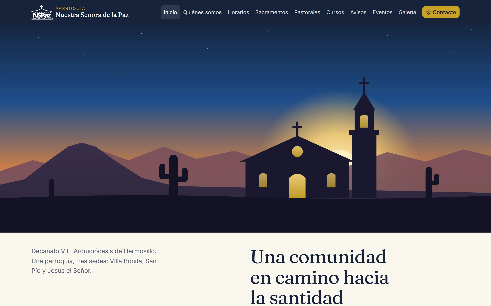

Es lo primero que ve quien llega. Está hecha de franjas a todo lo ancho, cada
una con su fondo, y **cada franja se dibuja solo si tiene algo que mostrar**: si
un día no hay evangelio publicado o no hay eventos próximos, esa franja
sencillamente no aparece, sin dejar hueco. De arriba abajo:

**La cabecera.** Una ilustración del templo al atardecer, con el Cerro de la
Campana al fondo, y debajo dos columnas: a la izquierda el decanato, la
arquidiócesis y las sedes de la parroquia («Una parroquia, tres sedes: Villa
Bonita, San Pío y Jesús el Señor»); a la derecha el lema, *Una comunidad en
camino hacia la santidad*, una presentación breve y dos botones, **Ver horarios
de misa** y **Requisitos de sacramentos**, que bajan a esas franjas de la misma
portada.

La presentación de esa cabecera es la del bloque **Presentación**: mientras esté
vacío, sale un texto de bienvenida fijo. En cuanto se sube al menos una
diapositiva al carrusel, ese espacio se convierte en un carrusel de fotos que
van pasando solas, y las próximas misas bajan justo debajo.

> **Se llena desde:** Contenido → Bloques (Presentación) y Comunicación →
> Carrusel. Las sedes, desde Parroquia → Centros.

**Próximas misas.** Al pie de la cabecera, las tres siguientes, calculadas desde
los horarios cargados y siempre en hora de Hermosillo. Cada una dice cuándo es
—«En 25 min», «Hoy», «Mañana» o el día de la semana—, la hora y el lugar. La
primera, la más próxima, va resaltada en azul.

> **Se llena desde:** Parroquia → Horarios.

**Evangelio del día.** Cuando el párroco publica la lectura del día, aparece en
dos columnas: el **Evangelio** a la izquierda y su **Reflexión** a la derecha,
con la fecha arriba. Para que la portada no se haga larguísima, cada columna
muestra su título y las primeras líneas, que se desvanecen, y un botón **Leer
completo** que la despliega; **Mostrar menos** la vuelve a recoger. Si un texto
es corto, sale completo y sin botón. Si ese día no hay reflexión, el evangelio
ocupa el centro él solo.

> **Se llena desde:** Contenido → Evangelio.

**Horarios.** La semana completa de misas, confesiones y oración, en pestañas
por día. Es la misma sección que la página de Horarios y se explica más abajo,
en su apartado.

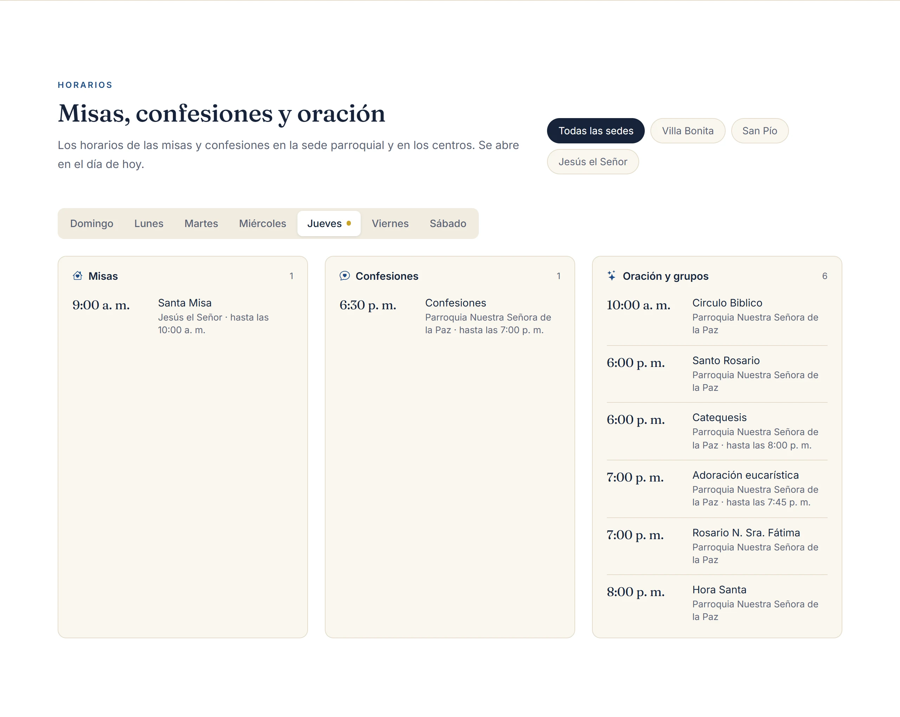

> **Se llena desde:** Parroquia → Horarios.

**Fiesta patronal.** Una franja azul que aparece sola en las semanas previas a
la fiesta de Nuestra Señora de la Paz, con una cuenta regresiva —«38 días para
la fiesta»—, las fechas de la novena y el aviso de la kermés. Se dibuja cuando
**la fiesta está publicada como evento** y faltan menos de dos meses, y se va
sola al día siguiente. El sistema la reconoce porque el título del evento dice
«fiesta patronal», y toma la novena y la kermés de los eventos publicados con
esas palabras en el título en las dos semanas anteriores y el mismo día. Si la
fiesta sigue en borrador, la franja no aparece.

> **Se llena desde:** Comunicación → Eventos.

**Sacramentos.** Todos los sacramentos en una lista que se despliega: al tocar
uno se abren un resumen, sus **requisitos** y sus **documentos**, la aportación
y un enlace a su ficha completa. Al lado va la tarjeta de la **oficina
parroquial**, con su horario y botones para llamar o escribir por WhatsApp.

> **Se llena desde:** Parroquia → Sacramentos, y la oficina desde
> Administración → Configuración.

**Pastorales.** Una tarjeta por comisión, con su lema —Celebrar, Anunciar,
Servir, Acompañar…—, cuántos grupos tiene, su descripción y la lista de sus
pastorales con el día en que se reúnen. Cada nombre lleva a la página de esa
pastoral, y **Quiero participar** baja al contacto.

> **Se llena desde:** Parroquia → Pastorales.

**Lo que viene.** Los próximos eventos **publicados**, en una cuadrícula, cada
uno con su día en un recuadro, el horario y la sede. Los de la fiesta patronal
—novena, fiesta y kermés— van en dorado y con estrella.

> **Se llena desde:** Comunicación → Eventos.

**Cursos, avisos y Facebook.** Los próximos cursos, los tres avisos más
recientes publicados en el sitio, las publicaciones recientes de la página de
Facebook de la parroquia —tal cual las muestra Facebook, sin copiar nada a
mano— y las **Ligas de interés**.

> **Se llena desde:** Comunicación → Cursos, Comunicación → Avisos,
> Administración → Configuración (la dirección de Facebook) y Contenido →
> Bloques (Ligas de interés).

**Quiénes somos.** En azul noche, la misión y la visión de la parroquia y una
tarjeta por sede con su dirección. Un enlace lleva a la página completa, con el
equipo pastoral.

> **Se llena desde:** Contenido → Bloques (Misión y Visión) y Parroquia →
> Centros.

**Contacto.** La dirección —que abre Google Maps—, el teléfono, el WhatsApp, el
correo y el horario de oficina, con el mapa al lado y los botones **Síguenos en
Facebook** y **Escríbenos**, que lleva al formulario.

> **Se llena desde:** Administración → Configuración.

Así se ve la portada entera, con todas esas franjas una debajo de otra:

> **El bloque «Bienvenida» ya no sale en la portada.** Con el diseño nuevo, el
> texto de la cabecera es el del bloque **Presentación**. Si se quiere un saludo
> del párroco, se escribe ahí.

## Quiénes somos

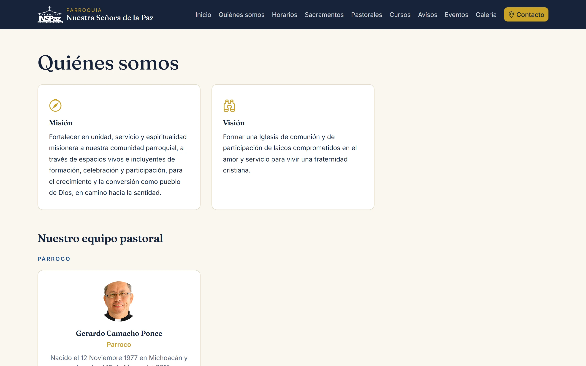

La presentación de la parroquia. Tiene tres partes:

1. **Historia, misión y visión**, tres textos libres. Cada uno se dibuja solo
   si tiene contenido.
2. **Nuestro equipo pastoral**: las fichas, agrupadas por tipo en este orden
   —párroco, vicario, diácono, religioso o religiosa, laico y personal de
   oficina—, cada una con su foto, su nombre, su cargo y, si la tiene
   capturada, una semblanza. Quien no tenga foto aparece con la inicial de su
   nombre en un círculo azul, no con un hueco.
3. **El organigrama**, con la estructura de la parroquia, y un botón para
   abrirlo en una versión pensada para imprimir en forma de árbol.

**Ojo con el equipo pastoral:** aquí sale **toda persona activa**, no una
selección. Dar de alta a alguien en Parroquia → Equipo pastoral lo publica en
esta página; para que deje de aparecer hay que marcar su ficha como inactiva.
Lo que nunca sale, de nadie, es su contacto: de la ficha se publican solo el
nombre, el cargo, la foto y la semblanza.

> **Se llena desde:** Contenido → Bloques (los tres textos), Parroquia →
> Equipo pastoral (las fichas) y Parroquia → Organigrama.

## Horarios

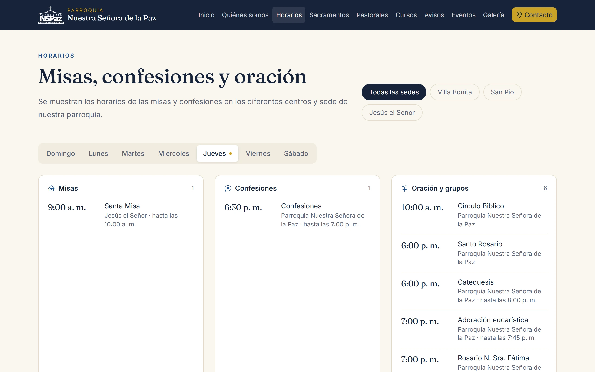

La semana en **pestañas, una por día**, que se abre en el día de hoy —marcado
con un punto dorado—. Cada día tiene tres tarjetas: **Misas**, **Confesiones**
y **Oración y grupos** (rosarios, adoración, catequesis…), cada una con cuántos
horarios trae. Cada renglón dice la hora, qué es —«Santa Misa», «Misa para
niños»— y en qué sede, con la hora de término si se capturó.

Arriba a la derecha están las **fichas de sede** —*Todas las sedes*, *Villa
Bonita*, *San Pío*, *Jesús el Señor*— para quedarse con una sola sin recargar
la página. Si en esa sede no hay nada ese día, la tarjeta lo dice: «Sin
confesiones este día en esta sede».

Es exactamente la misma sección que aparece en la portada. Los enlaces viejos
que llevaban a una sede, como `/horarios?centro=3`, siguen funcionando: abren
con esa ficha ya elegida.

Los horarios de temporada —San Pío cambia de hora en octubre y en junio— se
muestran solos según la fecha, de acuerdo con la vigencia que se les capturó.

> **Se llena desde:** Parroquia → Horarios, y las sedes desde Parroquia →
> Centros.

## Sacramentos

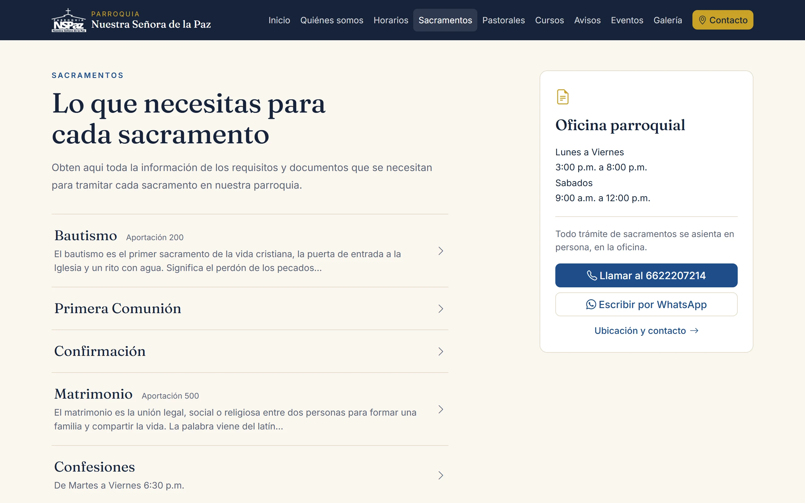

Un renglón por sacramento, con su nombre, la aportación y el principio de su
descripción, precedido de un texto introductorio si se capturó. Al tocar uno se
abre su ficha, con los requisitos y los documentos a presentar. Al lado, la
tarjeta de la **oficina parroquial**, con su horario y botones para llamar o
escribir por WhatsApp.

Es informativo: **no hay formulario de solicitud en línea**. Se decidió así;
los trámites se hacen en la oficina parroquial, y la página está para que quien
llegue sepa de antemano qué papeles llevar.

> **Se llena desde:** Parroquia → Sacramentos, y el texto de arriba desde
> Contenido → Bloques.

## Pastorales

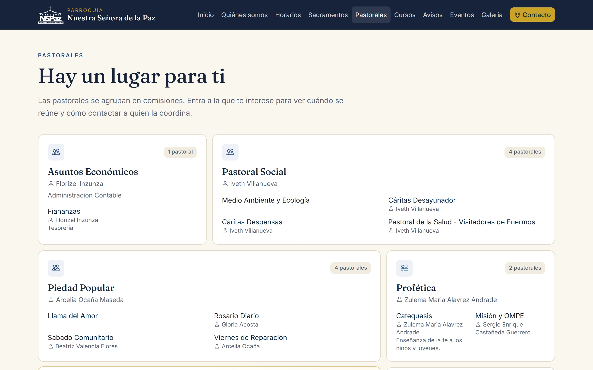

Todas las pastorales de la parroquia, bajo el título **Hay un lugar para ti**,
con una tarjeta por comisión —Litúrgica, Profética, De la Familia, De la
Comunicación, Pastoral Social…—. Cada tarjeta lleva quien coordina la comisión
y, dentro, sus pastorales, cada una con quien la lleva y su día de reunión o
una descripción corta. Las comisiones con cuatro pastorales o más ocupan el
doble de ancho, y la más grande va resaltada. Las pastorales que no pertenecen
a ninguna comisión llevan su propia tarjeta.

Al entrar a una pastoral se abre su página, con lo que ella misma publica: sus
actividades, sus avisos, sus próximos eventos, sus documentos para descargar y
un recuadro de **Información** con quien la coordina, su horario de reunión y
su correo. Si es una comisión, arriba aparecen además las pastorales que
agrupa, con enlace a cada una.

Dos detalles que suelen confundir:

- **El correo es de la pastoral, no de quien la coordina.** Se escribe a mano y
  sobrevive a los relevos, en vez de publicar el correo personal de quien esté
  al frente hoy.
- **Quien coordina puede ser un matrimonio.** En Matrimonios, AMA, JECSA y
  Raíces coordina una pareja, y así aparece.

> **Se llena desde:** Parroquia → Pastorales.

## Cursos

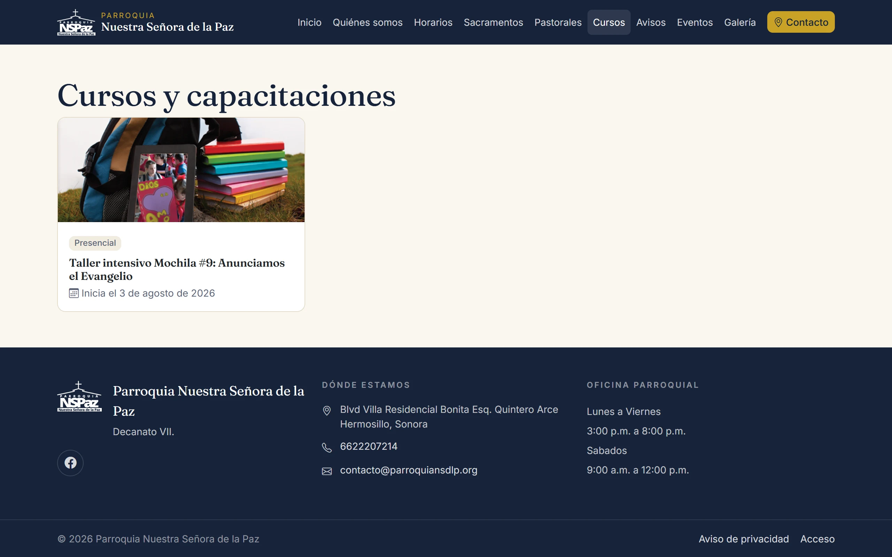

Los cursos y capacitaciones con inscripción abierta, cada uno con su foto, si
es presencial o en línea, y la fecha en que inicia. Al entrar a uno se ven los
detalles y, si acepta inscripciones, el formulario para apuntarse.

El formulario pide los datos de contacto de quien se inscribe y, cuando se
trata de un menor, también los del tutor. Antes de enviarlo hay que aceptar el
aviso de privacidad: sin esa palomita no se manda, y queda guardado a qué
versión del aviso dijo que sí.

Las inscripciones que llegan por aquí se leen en el panel; no se envían por
correo ni se pierden.

> **Se llena desde:** Comunicación → Cursos. Las inscripciones se atienden en
> Trámites → Inscripciones.

## Avisos

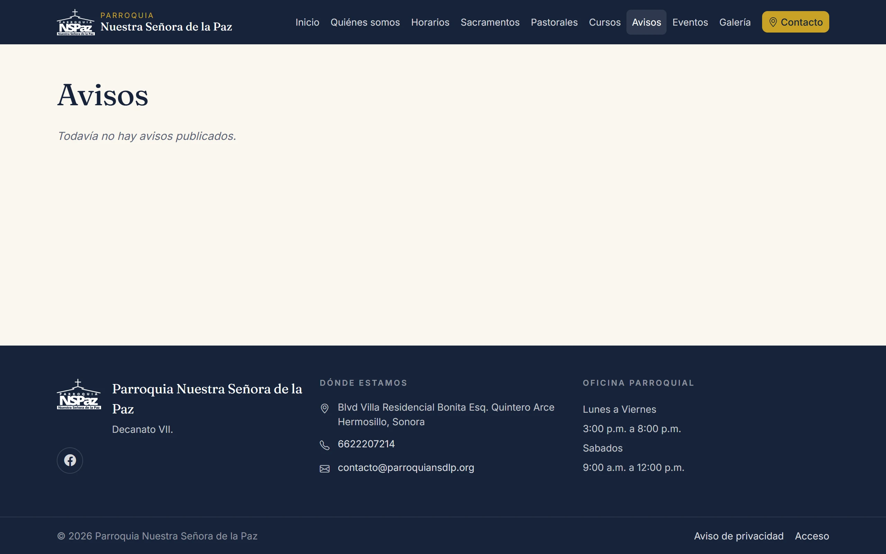

Los avisos publicados, en tarjetas, del más reciente al más viejo, con su
imagen, su tipo, su fecha y las primeras líneas. Al entrar a uno se lee
completo.

Aquí hay algo importante que el capítulo de Avisos explica a fondo: **no todo
aviso llega a esta página**. Una pastoral puede publicar un aviso solo hacia
dentro, para su propia gente, y ese se queda en el panel. A esta página solo
sale lo que se publicó para el sitio.

> **Se llena desde:** Comunicación → Avisos.

## Eventos

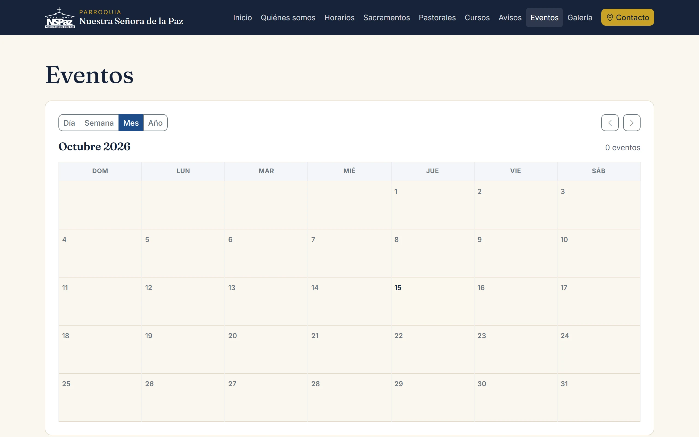

El calendario de la parroquia, en cuatro vistas —**Día, Semana, Mes y Año**—
que se cambian con los botones de arriba a la izquierda, y flechas para
moverse al periodo anterior o siguiente. A la derecha se dice cuántos eventos
tiene el periodo que se está viendo.

Un evento que dura varios días se marca en todos sus días, no solo el primero.
Al hacer clic en cualquiera se abre su detalle.

> **Se llena desde:** Comunicación → Eventos.

## Galería

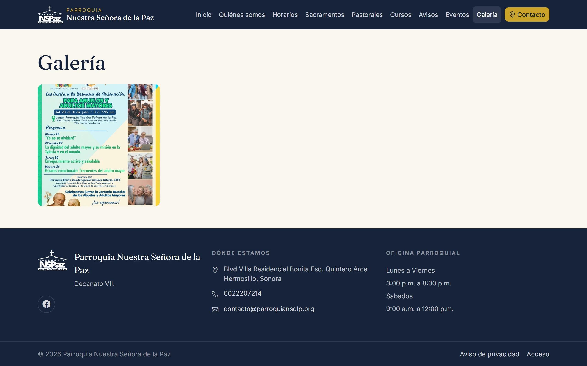

Las fotografías publicadas, en cuadrícula y por páginas. Al hacer clic en una
se abre grande, sin recortar, y se puede pasar a la siguiente con las flechas.

> **Se llena desde:** Comunicación → Galería.

## Contacto

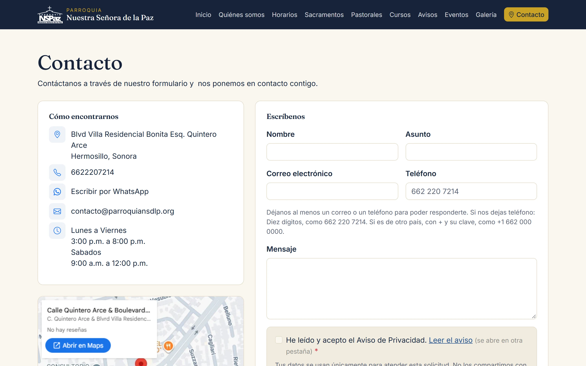

A la izquierda, cómo encontrar a la parroquia: dirección, teléfono, un enlace
para escribir por WhatsApp, el correo, el horario de oficina y un mapa.

A la derecha, el formulario. Pide nombre, asunto, y **al menos un correo o un
teléfono** —si no, no hay manera de responder—. Igual que en las inscripciones,
hay que aceptar el aviso de privacidad antes de enviar.

Los mensajes no van a un buzón de correo: llegan al panel, donde se leen, se
marcan como atendidos y quedan guardados.

> **Se llena desde:** Administración → Configuración (dirección, teléfonos,
> horario y mapa). Los mensajes se atienden en Comunicación → Mensajes.

## El pie de página

En todas las páginas, abajo: el escudo y el nombre de la parroquia con su
decanato, el icono de Facebook, la dirección, los teléfonos y el horario de la
oficina. Y en la última línea,
dos enlaces discretos:

- **Aviso de privacidad**, la versión vigente del aviso que se acepta en los
  formularios.
- **Acceso**, que es la puerta del panel. No está en el menú de arriba a
  propósito: el visitante no tiene por qué encontrársela, y quien trabaja en el
  panel la usa todos los días y sabe dónde está.

El capítulo 2 continúa por ahí.

## Qué no aparece nunca en el sitio

Conviene tenerlo claro desde el principio, porque es la primera duda de quien
empieza a capturar:

- **Los borradores.** Mientras un aviso, un evento, un curso o una página estén
  en borrador, nadie de fuera los ve.
- **Lo publicado solo hacia dentro.** Los avisos y cursos que una pastoral
  publica para su propia gente se quedan en el panel.
- **Los datos personales.** Los mensajes de contacto y las inscripciones a
  cursos no se publican nunca, ni completos ni en resumen. Del equipo pastoral
  salen al sitio el nombre, el cargo, la foto y la semblanza; nunca el teléfono
  ni el correo personal, que se capturan para uso del propio equipo.
