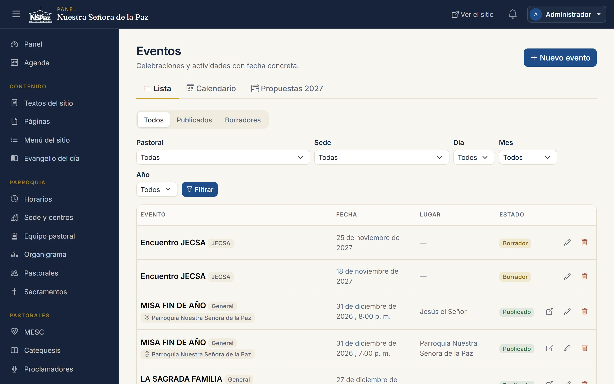
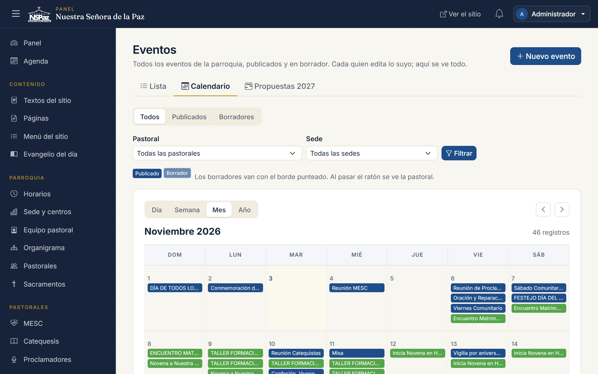
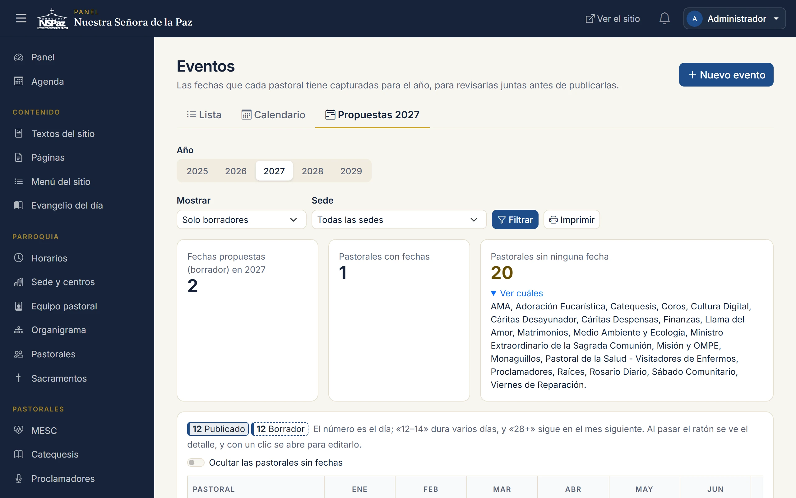
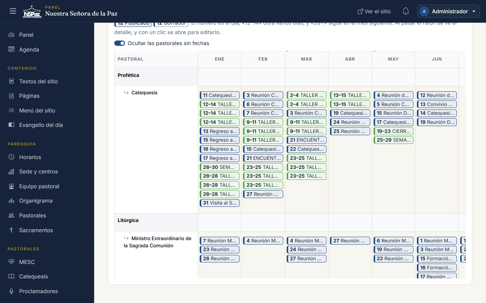
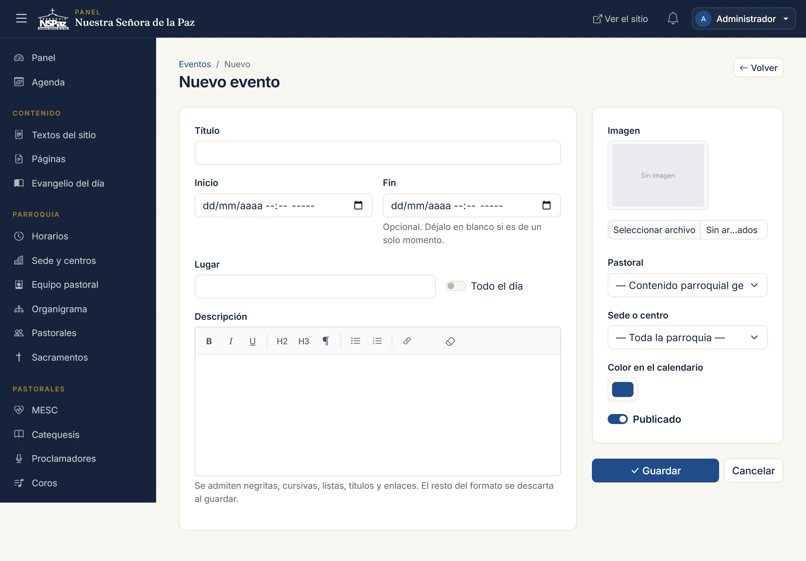

# 6. Eventos

Un evento es algo que pasa un día y a una hora: la posada, el retiro de
Adviento, la reunión mensual de una pastoral. Van al calendario del sitio y,
publicados o no, a la agenda interna del equipo.

**Menú:** Comunicación → Eventos.

Arriba hay tres pestañas, que son tres maneras de ver los mismos eventos:
**Lista**, **Calendario** y **Propuestas** del año que viene. Las dos últimas
se explican más abajo.

## El listado

Como el de avisos, pero con **más filtros, y todos se combinan**:

- **El estado**, en la fila de botones: *Todos*, *Publicados*, *Borradores*.
- **La pastoral** y **la sede**, cada una en su selector.
- **Día, mes y año**, en tres selectores sueltos. Son los que más se usan: la
  agenda de la parroquia tiene cientos de eventos cargados, y casi siempre se
  busca «lo de este mes». Se eligen y se pulsa **Filtrar**.

Cada renglón dice el título —con la pastoral y la sede en dos etiquetas
debajo—, la fecha con su hora, el lugar y el estado. A la derecha, el lápiz
para editar y el bote para borrar. Con el botón azul **Nuevo evento** se crea
uno.

### Sacar la lista: Excel, PDF o papel

Encima del listado, a la derecha, hay tres botones. Los tres llevan **los
eventos del filtro que tienes puesto, todos**, no solo los quince de la página
que estás viendo; y en orden de fecha, del primero al último.

- **Excel** descarga una hoja (`eventos-2026-03.xlsx`, por ejemplo: el nombre
  dice el filtro). Trae fecha, hora, cuándo termina, el evento, la pastoral, la
  sede, el lugar, si está publicado y quién lo capturó. Las fechas son fechas de
  verdad: en Excel se pueden ordenar y filtrar por mes, y la primera fila ya
  viene con los filtros puestos.
- **PDF** abre en otra pestaña una hoja lista para imprimir, partida por meses,
  y enseguida la ventana de impresión. Ahí, en **Destino**, se elige
  **«Guardar como PDF»** y se pulsa **Guardar**. El PDF lo hace el propio
  navegador; no hay que instalar nada.
- **Imprimir** abre esa misma hoja y la manda a la impresora.

Arriba de la hoja se dice cuántos eventos son, qué filtros se usaron y la fecha
en que se imprimió, para que el papel se entienda solo. Quien no tiene alcance
sobre toda la parroquia saca lo mismo que ve en su lista: lo de sus pastorales y
lo general.

## El calendario

La pestaña **Calendario** enseña los eventos **igual que el calendario del
sitio** —con sus vistas de *Día*, *Semana*, *Mes* y *Año*, y las flechas para
ir al periodo anterior o al siguiente—, pero con una diferencia que es la razón
de que exista: **aquí también salen los borradores**. Se distinguen por el
**borde punteado**; lo publicado va lleno.

Encima están los filtros:

- **Todos / Publicados / Borradores.** Con *Borradores* queda solo lo que
  todavía no se anuncia: lo que las pastorales tienen propuesto.
- **Pastoral** y **Sede**, para quedarse con lo de una comunidad.

Para ir lejos sin dar clic mes por mes, junto a las flechas están los
selectores de **mes** y **año**: se elige, por ejemplo, *Marzo* y *2027*, y el
calendario salta ahí sin perder la vista ni los filtros. (En la vista *Año* solo
aparece el del año.)

El botón **Imprimir** imprime —o guarda como PDF, eligiendo «Guardar como PDF»
en Destino— el periodo que estás viendo, en hoja horizontal y sin el menú ni los
botones. Los filtros que tenías puestos salen escritos junto al título, para que
en el papel se sepa si es «solo borradores» o «solo Catequesis».

Al pasar el ratón por una casilla se ve de qué pastoral es, y con un clic se
abre su formulario. **Solo es enlace lo que puedes editar**: lo de las demás
pastorales se ve, pero no lleva a ninguna parte. Es la misma regla de la
agenda interna (capítulo 8): aquí se mira todo, y se toca lo tuyo.

> La diferencia con la **Agenda** es que aquí solo hay eventos —la agenda
> junta también los cursos— y que el filtro de borradores es de verdad: la
> agenda los atenúa, este calendario puede quedarse solo con ellos.

## Las propuestas del año que viene

Cada pastoral captura sus fechas del año siguiente **como borrador**, con
**Publicado** apagado. La pestaña **Propuestas** las junta todas en una sola
pantalla para revisarlas antes de publicarlas.

**Arriba, tres números:** cuántas fechas hay propuestas, cuántas pastorales ya
propusieron algo y **cuántas no tienen ninguna fecha todavía**; con **Ver
cuáles** sale la lista, que es la de a quién hay que recordarle. Las Comisiones
no cuentan en esa lista, porque casi nunca programan a su nombre: lo hacen sus
dimensiones.

**Los filtros:**

- **Año.** Por omisión, el que viene. Se puede ver también el actual, el
  anterior o los siguientes.
- **Mostrar.** Por omisión *Solo borradores*, que son las propuestas. Con
  *Borradores y publicados* se ve el año completo, y con *Solo publicados*,
  lo que ya se anunció.
- **Sede**, si la parroquia tiene más de una.
- **Imprimir**, para llevar la tabla a la reunión de planeación.

**La tabla** tiene una fila por pastoral, agrupadas bajo su Comisión como en el
sitio, y una columna por mes. En cada casilla van las fechas de esa pastoral
ese mes: el número es el día, y luego el título. **«12–14»** es un evento que
dura del 12 al 14; **«28+»**, uno que sigue en el mes siguiente. Los borradores
van con borde punteado, igual que en el calendario. Al pasar el ratón se ve el
detalle —fecha completa, hora, lugar y sede—, y con un clic se abre para
editarlo o publicarlo. La primera fila, **General de la parroquia**, es lo que
no tiene pastoral.

El interruptor **Ocultar las pastorales sin fechas** deja solo las filas con
algo; la Comisión se queda como encabezado si alguna de sus dimensiones tiene
fechas. El navegador recuerda cómo lo dejaste.

> **Quién ve qué.** El administrador y el editor ven todas las pastorales y la
> lista de las que faltan. Una coordinación ve la misma tabla, pero solo con
> sus pastorales y sin esa lista: le sirve para revisar su propio año.

Para **publicar** una fecha ya aprobada no hace falta salir de aquí: se le da
clic, se enciende **Publicado** y se guarda.

## El formulario

### Cuándo y dónde

- **Título.** Obligatorio.
- **Inicio.** Fecha **y hora**. Es el único dato de tiempo obligatorio.
- **Fin.** Opcional. Se deja en blanco si el evento es de un solo momento; se
  llena cuando dura un rato, o varios días.
- **Todo el día.** Para lo que no tiene hora —una jornada, un día de campo—.
  Con esta palomita el calendario deja de mostrar la hora.
- **Lugar.** Texto libre: «Salón parroquial», «Templo», «Casa de retiros». Es
  distinto de la sede: la sede dice a qué comunidad pertenece el evento, el
  lugar dice dónde se junta la gente.
- **Descripción.** Con el editor de texto, para los detalles.

> **Un evento de varios días se marca en todos sus días.** Si pones inicio el
> viernes y fin el domingo, aparece el viernes, el sábado y el domingo, no solo
> el primer día. Es lo que se espera de un retiro o de un triduo.

### De quién es

- **Pastoral.** Igual que en avisos: si administras una sola, va fija; si
  varias, se elige; y quien puede publicar de toda la parroquia tiene además
  **«Contenido parroquial general»**.
- **Sede o centro.** En qué comunidad ocurre. Se puede dejar en **«Toda la
  parroquia»** cuando no es de una sede en particular. Este dato es el que
  permite que el calendario del sitio se pueda filtrar por comunidad.
- **Imagen.** La foto de la tarjeta en el sitio.
- **Color en el calendario.** El color con el que se dibuja su casilla, tanto
  en el calendario del sitio como en la agenda interna. Sirve para distinguir
  de un vistazo lo de una pastoral, o para separar lo ordinario de lo
  extraordinario. Si no lo tocas, va el azul de la casa.

### Publicar

Los eventos **no tienen los tres escalones de los avisos**: llevan un solo
interruptor, **Publicado**, con dos posiciones. Apagado es borrador —lo ve el
equipo en la agenda interna y en el calendario y las propuestas de Eventos,
nadie más—; encendido sale en el calendario del
sitio. **En un evento nuevo viene encendido**: si todavía no quieres que se vea,
apágalo antes de guardar.

Si tu cuenta no puede publicar, el interruptor no aparece: lo que captures
queda en borrador hasta que alguien con permiso lo publique.

## Dónde acaba

- **En el sitio**, en la sección Eventos, con sus cuatro vistas —día, semana,
  mes y año— y en la portada, en la franja **Lo que viene en la parroquia**.
- **La fiesta patronal tiene franja propia.** Cuando se publica el evento cuyo
  título dice «fiesta patronal» —el de la sede, no el de un centro— y faltan
  menos de dos meses, la portada muestra una franja con la cuenta regresiva.
  Si además están publicadas la novena y la kermés, con esas palabras en el
  título, salen ahí mismo y en dorado en **Lo que viene en la parroquia**.
  Mientras sigan en borrador, la portada no dice nada de la fiesta.
- **En la agenda interna** del panel, publicado o no, junto a los cursos y
  junto a lo de las demás pastorales. Eso es el capítulo 8.

## Cambiar o quitar un evento

El lápiz abre el formulario; apagar **Publicado** lo retira del sitio sin
borrarlo, y el bote de basura lo elimina, preguntando antes.

Para algo que se repite todas las semanas —la misa, la hora santa, el ensayo
del coro— **no se capturan eventos uno por uno**: eso son horarios, y viven en
Parroquia → Horarios, que es el capítulo 11.
