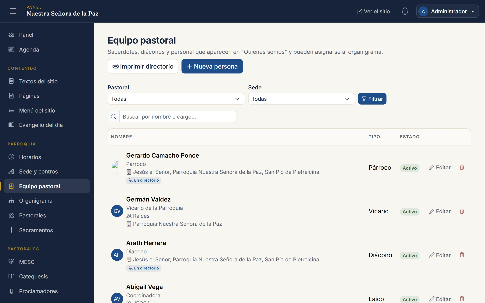
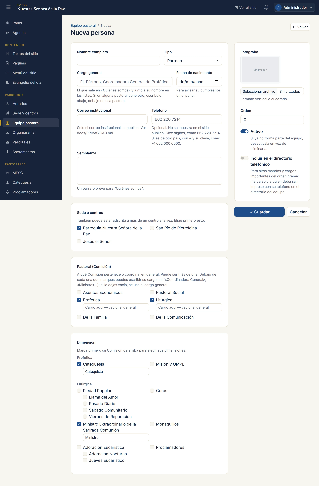
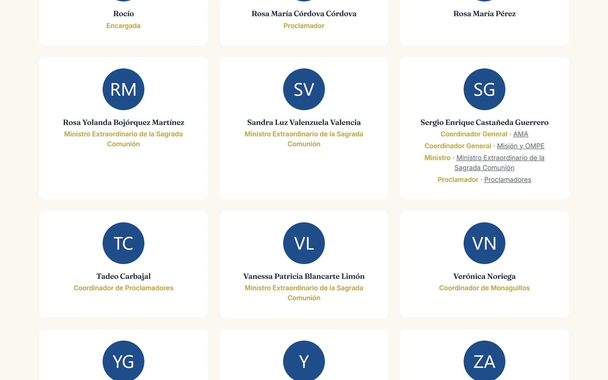
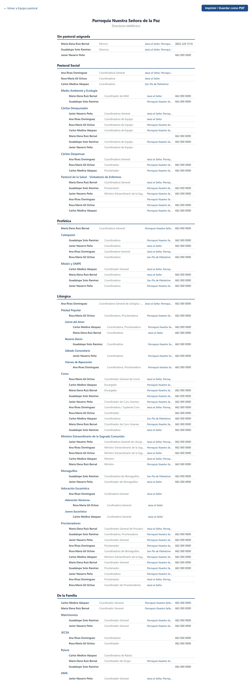
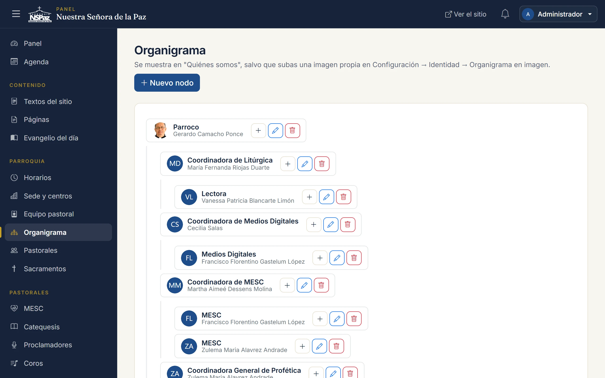

# 12. Equipo pastoral y organigrama

El equipo pastoral es **el catálogo de personas de la parroquia**, y es el
módulo del que más cosas dependen. Vale la pena entenderlo antes que los de las
pastorales con módulo propio, porque todos beben de aquí.

**Menú:** Parroquia → Equipo pastoral y Parroquia → Organigrama.

## Por qué este catálogo está en el centro

De estas fichas salen, sin volver a escribir el nombre de nadie:

- Quién aparece en **«Quiénes somos»** en el sitio.
- Quién **coordina cada pastoral**.
- Quién es **instructor** de un curso.
- Quién es **ministro de MESC, catequista, proclamador o corista**.
- **De quién es cada cuenta** del panel: al dar de alta un usuario se elige una
  persona del equipo, y de ahí vienen su nombre, su teléfono y su foto.
- Los **cumpleaños** que la pantalla de inicio avisa cada mes.

Todo eso existe porque el problema se encontró tres veces: la misma
coordinadora estaba escrita como «Zulema» en un catálogo, «Zulema Alvarez» en
otro y con su nombre completo en su ficha. Con una sola lista, el nombre se
corrige en un sitio y se corrige en todos.

## El listado

Un buscador por nombre o cargo, filtros por pastoral y por sede, y una tabla
con la foto, el nombre, el cargo, las pastorales y sedes de cada quien, su tipo
y si está activa. Quien coordina una pastoral lleva además una estrella que lo
dice.

## La ficha

- **Nombre completo.** El de verdad, completo: es el que se va a ver en todas
  partes.
- **Tipo.** Párroco, vicario, diácono, religioso o religiosa, laico, personal
  de oficina. Es lo que agrupa las fichas en «Quiénes somos».
- **Cargo general.** Una línea: «Encargada de Coro Infantil», «Coordinadora
  General de Profética». Es el que sale junto a su nombre en las listas para
  elegir personas y, en «Quiénes somos», junto a los cargos de cada pastoral
  (ver «Cargo aquí», más abajo).
- **Fecha de nacimiento.** Es lo que alimenta los cumpleaños del panel. **No se
  publica en el sitio**: solo se usa puertas adentro.
- **Correo institucional** y **Teléfono.** El correo institucional es el único
  que se publica; el teléfono es para uso del equipo —de ahí salen los botones
  de WhatsApp de los listados— y nunca aparece en el sitio.
- **Semblanza.** Un párrafo breve para «Quiénes somos».
- **Foto.**
- **Su pareja.** Se elige de la misma lista. Vale en toda la parroquia: el
  panel de cada pastoral dice con quién está cada quien, y cuando los dos
  coordinan juntos una pastoral, sale marcada con un corazón. Márcala solo si
  de verdad son matrimonio o pareja: dos personas que coordinan juntas no
  necesitan estar ligadas aquí. Este campo **solo aparece al editar** una
  ficha ya guardada: en una nueva todavía no hay a quién ligarla.
- **Sede o centros**, **Pastoral (Comisión)** y **Dimensión**, en tres listas
  de palomitas. Las dimensiones de una comisión se pueden marcar después de
  marcar la comisión arriba; los grupos de una dimensión —como Rosario Diario
  dentro de Piedad Popular— salen sangrados debajo de ella. Se puede
  pertenecer a varias de cada una.
- **Cargo aquí**, debajo de cada pastoral marcada. Quien está en varias
  pastorales suele tener un cargo distinto en cada una: Zulema es Coordinadora
  General en Profética, Coordinadora en Catequesis, Misionera en Misión y OMPE,
  Ministro en MESC y Coordinadora de Equipos en Cáritas Desayunador. Cada uno
  va debajo de su pastoral, y si se deja vacío se usa el cargo general. Al
  escribir, el campo sugiere los cargos que ya se usan, para que «Coordinadora»
  no acabe escrito de tres formas. Este cargo es solo el título: quién coordina
  una pastoral se elige en la pastoral (capítulo 13).

  

  En **«Quiénes somos»** la tarjeta de cada persona lleva todos sus cargos,
  cada uno con su pastoral: «Coordinadora General · Profética», «Ministro ·
  MESC». Van primero los de coordinación general, luego los de coordinación y
  al final el resto. El cargo general sale también, sin pastoral, pero solo si
  dice algo distinto: si es «Coordinadora General» o «Coordinadora General de
  Profética» y ya está «Coordinadora General · Profética», no se repite. Ojo con
  los errores de dedo: «Coordiandora General» ya no se reconoce como el mismo,
  y sale aparte. Las pastorales inactivas no se publican, y su cargo tampoco.
- **Activa**, el interruptor de siempre.
- **Incluir en el directorio telefónico.** Aparte de "Activa": no es para todo
  el equipo, es para altos mandos y cargos importantes del organigrama —a
  quien tenga sentido imprimir con su teléfono en un directorio del equipo.
  Se marca ficha por ficha, igual que se decide quién sale en "Quiénes somos".

> **Dar de alta a alguien aquí lo publica en el sitio.** Toda persona activa
> aparece en «Quiénes somos» con su nombre, sus cargos, su foto y su semblanza.
> Para que deje de aparecer —alguien que dejó su encargo— se marca la ficha
> como inactiva; no hace falta borrarla, y conviene no hacerlo: su nombre puede
> estar todavía colgando del organigrama o de un catálogo.

## El directorio telefónico

Desde el listado, el botón **"Imprimir directorio"** abre en una pestaña
aparte una hoja lista para imprimir o guardar como PDF con solo a quienes se
marcó con la casilla "Incluir en el directorio telefónico" de su ficha, con su
cargo, sede y teléfono. A diferencia del organigrama, esta hoja no es
pública: lleva teléfonos, que nunca se publican en el sitio. Sin correo: es
un directorio telefónico, y el institucional ya se ve en "Quiénes somos".

Va agrupado por pastoral, siguiendo la misma jerarquía de Comisión y
Dimensión que el resto del sistema: cada Comisión (por ejemplo, Litúrgica)
encabeza su bloque, y debajo, indentadas, sus dimensiones (Coros, MESC,
Proclamadores…); una dimensión con grupos, como Piedad Popular, lleva los
suyos un escalón más adentro. Dentro de cada una, primero aparece quien la coordina —quien
coordina la Comisión entera, y luego quien coordina cada dimensión en
concreto—, después quien tiene "Encargado" o "Encargada" en su cargo, y al
final el resto, por nombre. Quien está marcada para el directorio pero no
pertenece a ninguna pastoral —el párroco, el vicario, el personal de oficina—
va en el grupo "Sin pastoral asignada", que encabeza la hoja, antes de la
primera Comisión.

## El organigrama

Es el árbol de la parroquia: quién depende de quién. Se arma con **nodos**, y
cada nodo tiene:

- **Título.** Lo que se dibuja en la cajita.
- **Depende de.** De qué nodo cuelga. Dejarlo vacío lo pone en la raíz.
- **Pastoral** y **Persona**, los dos opcionales: si se eligen, el nodo queda
  ligado a esa pastoral o a esa ficha, y el organigrama muestra el nombre al
  día sin tener que volver aquí cuando haya un relevo.
- **Orden entre sus iguales**, para colocarlo entre sus hermanos.
- **Visible en el sitio.**

En el sitio, el organigrama sale al final de «Quiénes somos», con un botón para
abrirlo en una **versión para imprimir**, en forma de árbol, que es la que se
usa cuando hace falta en papel.
