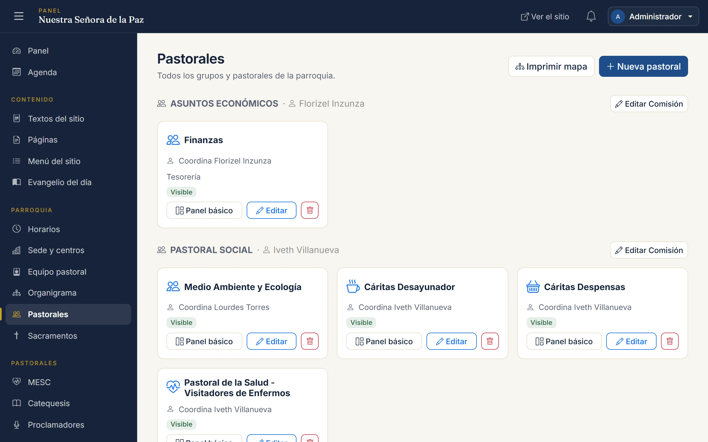
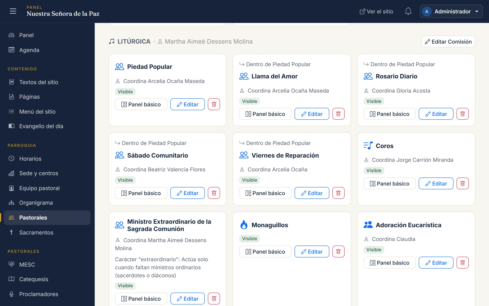
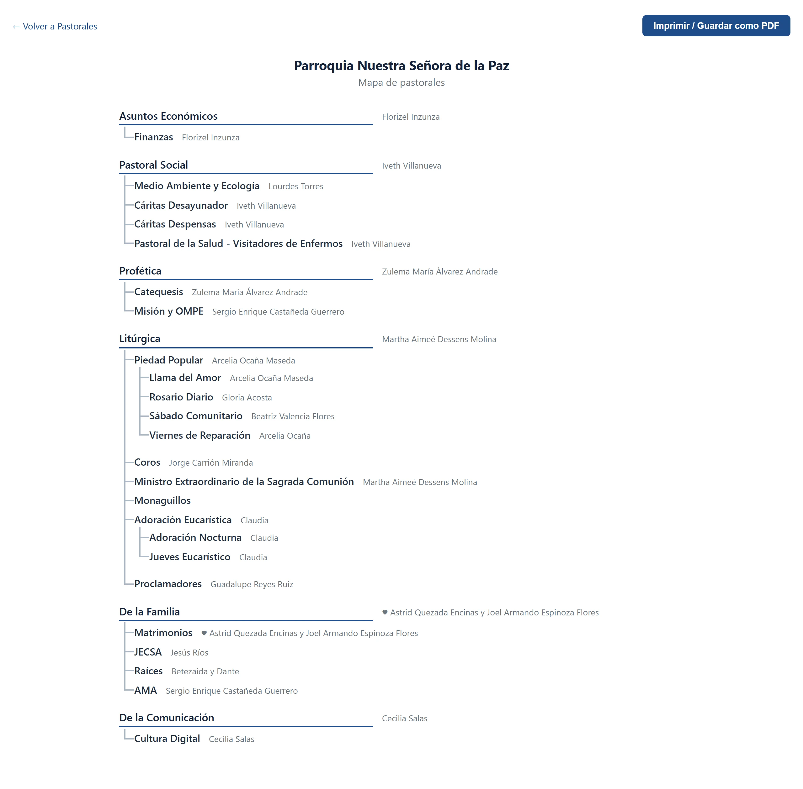
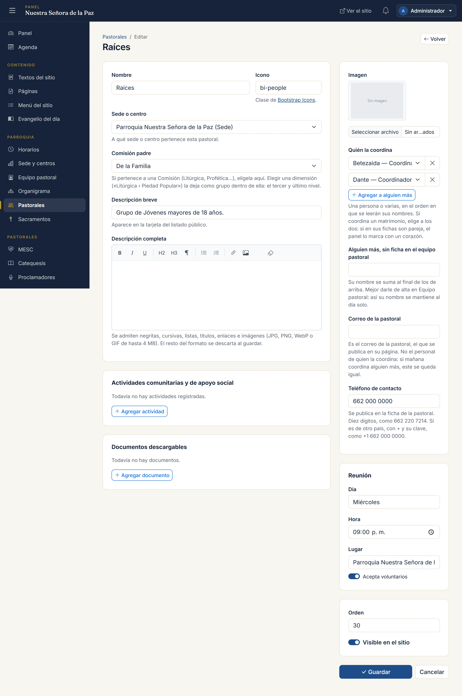
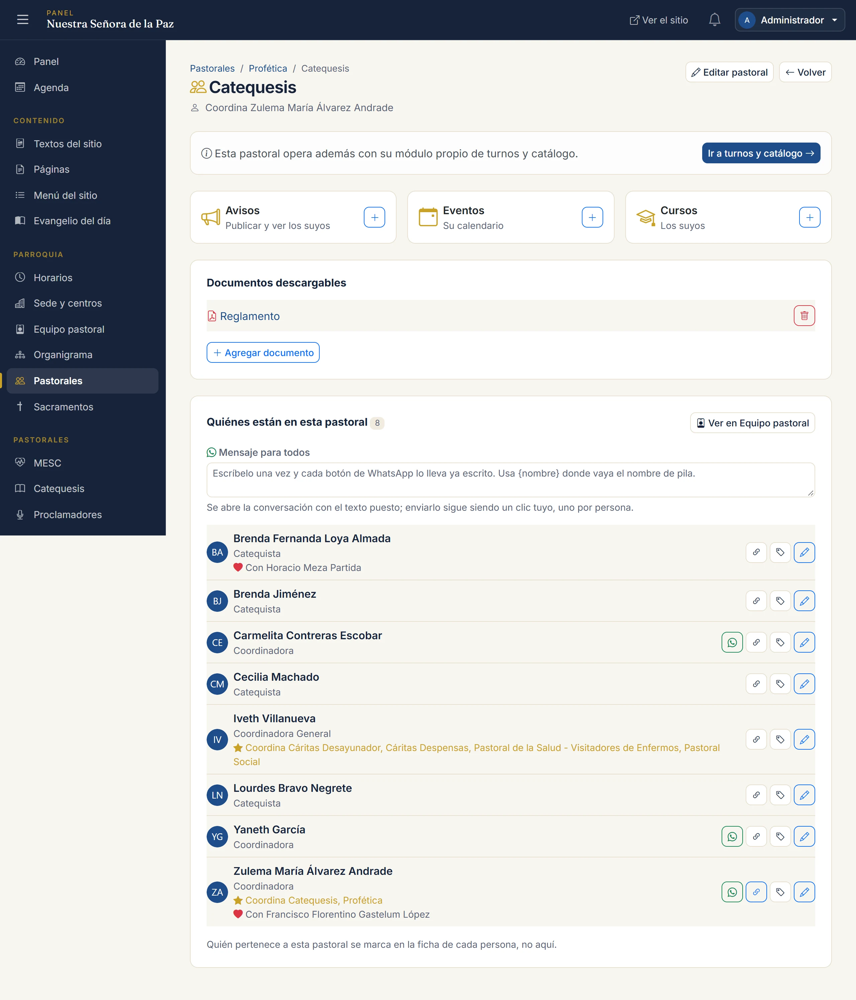
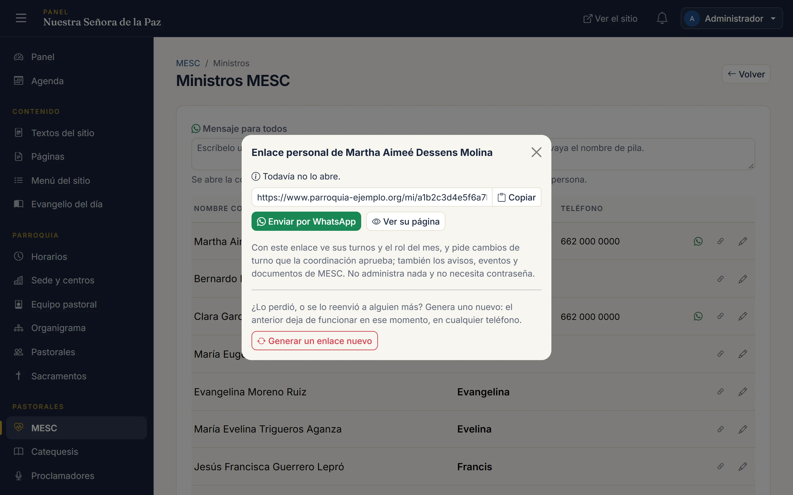
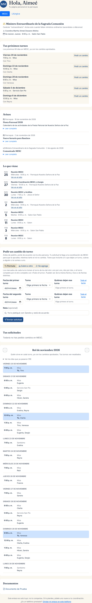

# 13. Pastorales

El catálogo de las pastorales de la parroquia y, para cada una, su ficha
pública y su panel de trabajo.

**Menú:** Parroquia → Pastorales.

## El listado

Las pastorales **se agrupan por comisión** —Litúrgica, Profética, De la
Familia, De la Comunicación, Pastoral Social, Asuntos Económicos—, igual que
en el sitio. Cada
tarjeta lleva el nombre, quién coordina y dos botones: **Panel básico** y
**Editar**.

Hay hasta **tres niveles**: la comisión, sus dimensiones y, dentro de una
dimensión, sus grupos. Hoy el único caso es **Piedad Popular**, una dimensión
de Litúrgica que agrupa a Llama del Amor, Rosario Diario, Sábado Comunitario
y Viernes de Reparación. En el listado, la tarjeta de cada grupo aparece
justo después de la de su dimensión y dice «Dentro de Piedad Popular».

Una **comisión** es una pastoral como cualquier otra, con su ficha y quien
la coordina; lo que la hace comisión es que otras la tienen marcada como su
«comisión padre». Y eso tiene una consecuencia práctica que conviene recordar:
quien coordina una comisión recibe también lo que publican hacia dentro las
pastorales que agrupa.

### El mapa de pastorales para imprimir

El botón **"Imprimir mapa"** del listado abre en una pestaña aparte un árbol
de la jerarquía completa, listo para imprimir o guardar como PDF: cada
Comisión encabeza su bloque y, indentadas debajo con una guía vertical, sus
dimensiones —Litúrgica con Coros, MESC, Proclamadores…— y, un escalón más
adentro, los grupos de una dimensión, cada una con quién la coordina al lado. No es un árbol de cajitas conectadas por líneas como el del
organigrama: con Comisiones de hasta seis hijas, una hoja no alcanzaría a lo
ancho.

## La ficha

Se abre con **Editar**. Es la que alimenta la página pública de la pastoral.

### Identidad

- **Nombre** e **Icono** —una clase de Bootstrap Icons; el que se ve junto al
  nombre en el panel y en el sitio—.
- **Sede o centro** a la que pertenece.
- **Comisión padre.** Con qué comisión se agrupa. Vacío, la pastoral queda
  suelta. La lista ofrece también las dimensiones, escritas con su comisión
  delante («Litúrgica › Piedad Popular»): elegir una deja a la pastoral como
  grupo dentro de esa dimensión, el tercer y último nivel. Solo aparecen las
  opciones que no pasan de tres niveles —a una pastoral que ya agrupa a otras,
  solo comisiones—, y si algo no cabe, el panel no guarda y explica por qué.
- **Descripción breve**, la línea de la tarjeta del listado público, y el
  **contenido**, el texto largo de su página. En una comisión, la descripción
  breve es la que sale en su tarjeta de la portada; si se deja vacía, la
  portada pone un texto propio para las comisiones de siempre.
- **Reunión: Día y Hora.** Salen junto al nombre de la pastoral en las
  tarjetas de la portada y del listado público.

### Quién la lleva y cómo se le escribe

- **Quién la coordina.** Se elige **del equipo pastoral**, no se escribe a
  mano, y pueden ser **una persona o varias**: cada una en su renglón, y
  **"Agregar a alguien más"** abre el siguiente. La **×** de cada renglón lo
  quita. Los nombres se leen en ese orden —«Coordinan Betesaida y Dante»—.
  Si coordina un matrimonio, se eligen los dos: si en sus fichas están
  marcados como pareja, el panel lo pinta con un corazón; si no lo son, con
  dos siluetas. Debajo hay un campo de nombre libre para alguien que todavía
  no tiene ficha en el equipo pastoral: su nombre se suma al final de los
  elegidos.
- **Correo de la pastoral** y **teléfono de contacto**. Se publican en su
  página. **El correo es de la pastoral, no de quien la coordina**: se escribe
  a mano a propósito, para que sobreviva a los relevos en vez de publicar el
  correo personal de quien esté al frente hoy.
- **Reunión**: el lugar, junto al día y la hora de arriba. Es lo que la gente
  busca cuando quiere acercarse.
- **Acepta voluntarios**, una palomita que lo dice en su página.
- **Orden**, para colocarla dentro de su comisión.
- **Documentos**, que se suben aquí y se descargan desde su página.

## El panel básico

Es la pantalla de trabajo de la pastoral, y la que hace que una pastoral nueva
pueda operar **sin que nadie escriba una línea de código**. Tiene cuatro
partes:

**Los tres accesos**: Avisos, Eventos y Cursos, cada uno con un **+** para
crear uno nuevo ya asignado a esta pastoral. Es el atajo que evita tener que
acordarse de elegir la pastoral en el formulario.

**Documentos descargables.** Los mismos de la ficha, aquí a la mano: se agregan
y se quitan sin salir de esta pantalla. Son los que la gente baja desde la
página pública de la pastoral.

**Quiénes están en esta pastoral.** La lista de su gente, que sale del equipo
pastoral: alguien aparece aquí porque en su ficha está marcada esta pastoral.
Cada renglón lleva su botón de **WhatsApp** y, debajo del nombre, **su cargo en
esta pastoral** —o, si aquí no tiene uno propio, el que se le muestra en
general—.

Quien coordina la pastoral ve además, en cada renglón, un botón con una
**etiqueta**: abre un cuadro para escribir el cargo de esa persona aquí
(«Ministro», «Coordinadora de Equipos»…). Cambia solo ese dato y solo en esta
pastoral: ni el cargo general ni nada más de la ficha. Si se deja vacío, aquí se
muestra el que tiene en general, y el cuadro dice cuál.

El botón de la **cadena** es su **enlace personal**: su página en la parroquia,
sin cuenta ni contraseña. Se explica más abajo.

**Mensaje para todos.** Encima de la lista hay un cuadro de texto: se escribe
el aviso una vez —«recordatorio: reunión el jueves a las 7»— y cada botón de
WhatsApp abre la conversación de esa persona **con el texto ya puesto**.
Escribir `{nombre}` en el mensaje lo sustituye por el nombre de pila de cada
quien.

Dos cosas que conviene saber de ese cuadro: **enviar sigue siendo un clic tuyo,
uno por persona** —el sistema no manda nada solo—, y **el texto no se guarda en
ningún lado**: es un borrador del navegador, no un ajuste del sitio.

**Si la pastoral tiene módulo propio** —MESC, Catequesis, Proclamadores,
Coros—, arriba aparece un aviso con el botón **Ir a turnos y catálogo**, que
lleva a él. Esos módulos son los capítulos 15 a 18.

## El enlace personal de cada integrante

Casi nadie de una pastoral tiene cuenta en el panel, y no hace falta: para
enterarse de lo suyo basta su **enlace personal**. Es una dirección que es solo
suya; la abre en su teléfono, sin usuario ni contraseña, y ve su página en la
parroquia.

**Dónde está el botón.** Es el de la **cadena**, en cada renglón de:

- **Quiénes están en esta pastoral**, en el panel de cualquier pastoral. Lo ve
  quien la coordina.
- Las listas de los módulos: **Ministros** (MESC), **Proclamadores**,
  **Integrantes** (Coros) y **Catequistas**. Lo ve quien puede editar esa lista.

El enlace nace de la ficha del equipo pastoral la primera vez que se pide, así
que un renglón escrito a mano, sin ficha ligada, no tiene botón. El color de la
cadena dice en qué va: **gris**, todavía no tiene enlace; **azul**, ya tiene y
no lo ha abierto; **verde**, ya lo abrió.

**El cuadro.** Al pulsar la cadena se abre un cuadro con:

- Si ya lo abrió: «Todavía no lo abre», o «Lo abrió por última vez el…».
- La dirección, con su botón **Copiar**.
- **Enviar por WhatsApp**: abre la conversación con esa persona con el mensaje
  ya escrito —su nombre, su enlace y lo que va a encontrar—. Enviarlo sigue
  siendo un clic tuyo. Si no tiene teléfono registrado, WhatsApp te deja elegir
  a quién mandárselo.
- **Ver su página**: la abre tal como la verá, en **vista previa**. Lo que
  hagas ahí no cuenta: no queda como que la abrió y no deja pedir nada a su
  nombre.
- **Generar un enlace nuevo**, para cuando lo perdió o se lo reenvió a alguien:
  el anterior deja de funcionar en ese momento, en cualquier teléfono.

Si en su ficha no está marcada esta pastoral, el cuadro lo avisa antes de que
lo mandes: su página no le mostraría nada de ella.

### Lo que ve en su página

Lo saluda por su nombre —el corto, si en MESC tiene uno— y tiene una pestaña
por cada pastoral marcada en su ficha. En cada una:

- Quién la coordina y cuándo se reúnen.
- Los **avisos** publicados hacia dentro para esa pastoral, para la Comisión que
  la agrupa y para toda la parroquia.
- **Lo que viene**: los eventos de su pastoral, también los internos que no
  salen en el sitio.
- Los **documentos** de la pastoral.

En **MESC** y **Proclamadores**, si además está activa en la lista de esa
pastoral, ve también **sus próximos turnos** —cada uno con su botón **Pedir
un cambio**—, **el rol del mes**, con sus turnos resaltados, y **sus
solicitudes**, y puede **pedir un cambio de turno**, que la coordinación
aprueba (capítulo 15). Esas pestañas van primero.

No administra nada: mira, y en esos dos módulos, pide. Al pie de su página
está **Olvidar mi enlace en este teléfono**, para cuando lo abrió en uno
prestado.

> **Es solo suyo.** Quien tenga el enlace ve esa página, así que se manda a
> cada quien, no a un grupo. Deja de funcionar cuando su ficha se marca
> inactiva; cada pastoral desaparece de su página cuando se le desmarca en su
> ficha, y sus turnos, cuando se le pone inactiva en la lista del módulo. Si
> alguien más lo tiene, **Generar un enlace nuevo**.

## Dar de alta una pastoral

Se crea desde el listado, se llena su ficha y, desde ese momento, **ya tiene su
panel básico**: sus avisos, sus eventos, sus cursos y sus documentos, sin más
trámite.

Lo que no ocurre solo es que aparezca como entrada propia en el menú lateral
del panel, junto a MESC o Catequesis. Eso hoy no se activa desde el panel: es
un cambio que hay que pedirle a quien lleva el sistema. La pastoral funciona
igual mientras tanto; se entra por Parroquia → Pastorales → Panel básico.
