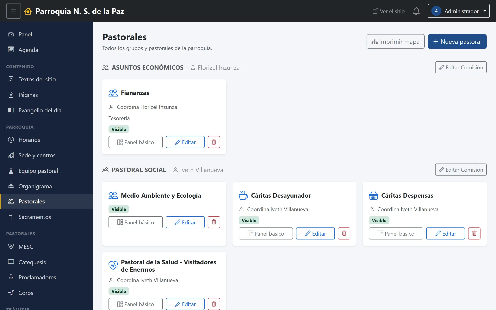
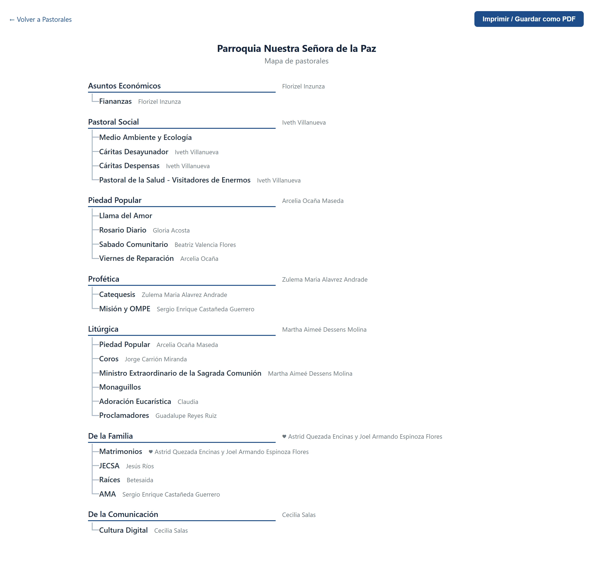
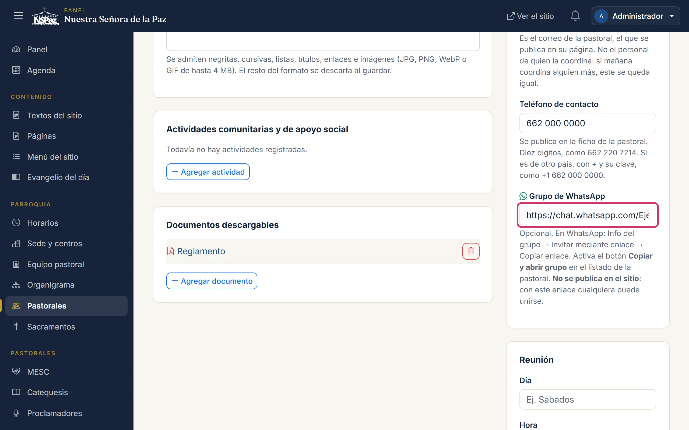
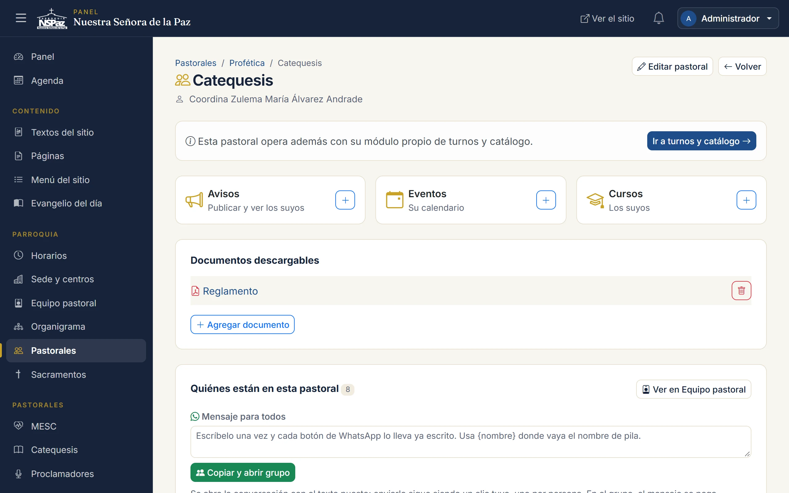

# 13. Pastorales

El catálogo de las pastorales de la parroquia y, para cada una, su ficha
pública y su panel de trabajo.

**Menú:** Parroquia → Pastorales.

## El listado

Las pastorales **se agrupan por comisión** —Litúrgica, Profética, De la
Familia, De la Comunicación, Pastoral Social, Piedad Popular, Asuntos
Económicos—, igual que en el sitio. Cada
tarjeta lleva el nombre, quién coordina y dos botones: **Panel básico** y
**Editar**.

Una **comisión** es una pastoral como cualquier otra, con su ficha y su
responsable; lo que la hace comisión es que otras la tienen marcada como su
«comisión padre». Y eso tiene una consecuencia práctica que conviene recordar:
quien coordina una comisión recibe también lo que publican hacia dentro las
pastorales que agrupa.

### El mapa de pastorales para imprimir

El botón **"Imprimir mapa"** del listado abre en una pestaña aparte un árbol
de la jerarquía completa, listo para imprimir o guardar como PDF: cada
Comisión encabeza su bloque y, indentadas debajo con una guía vertical, sus
dimensiones —Litúrgica con Coros, MESC, Proclamadores…—, cada una con quién la
coordina al lado. No es un árbol de cajitas conectadas por líneas como el del
organigrama: con Comisiones de hasta seis hijas, una hoja no alcanzaría a lo
ancho.

## La ficha

Se abre con **Editar**. Es la que alimenta la página pública de la pastoral.

### Identidad

- **Nombre** e **Icono** —una clase de Bootstrap Icons; el que se ve junto al
  nombre en el panel y en el sitio—.
- **Sede o centro** a la que pertenece.
- **Comisión padre.** Con qué comisión se agrupa. Vacío, la pastoral queda
  suelta.
- **Descripción breve**, la línea de la tarjeta del listado público, y el
  **contenido**, el texto largo de su página. En una comisión, la descripción
  breve es la que sale en su tarjeta de la portada; si se deja vacía, la
  portada pone un texto propio para las comisiones de siempre.
- **Reunión: Día y Hora.** Salen junto al nombre de la pastoral en las
  tarjetas de la portada y del listado público.

### Quién la lleva y cómo se le escribe

- **Responsable.** Se elige **del equipo pastoral**, no se escribe a mano. Si
  la persona elegida tiene pareja marcada en su ficha, la pastoral aparece
  coordinada por el matrimonio. Debajo hay un campo de nombre libre, que solo
  se usa si no eliges a nadie del equipo.
- **Correo de la pastoral** y **teléfono de contacto**. Se publican en su
  página. **El correo es de la pastoral, no de quien la coordina**: se escribe
  a mano a propósito, para que sobreviva a los relevos en vez de publicar el
  correo personal de quien esté al frente hoy.
- **Grupo de WhatsApp.** Opcional. Es el enlace de invitación del grupo de la
  pastoral: en WhatsApp, **Info del grupo → Invitar mediante enlace → Copiar
  enlace**, y se pega aquí tal cual. Con él aparece el botón **Copiar y abrir
  grupo** en el panel básico y en el listado del módulo de la pastoral. Solo
  acepta enlaces que empiezan con `https://chat.whatsapp.com/`; un número de
  teléfono no sirve.

  

  > **Este enlace no se publica en el sitio**, y es a propósito: con él
  > cualquiera puede unirse al grupo. Si llegara a circular, en WhatsApp se
  > restablece (Info del grupo → Invitar mediante enlace → Restablecer enlace)
  > y se pega aquí el nuevo.
- **Reunión**: el lugar, junto al día y la hora de arriba. Es lo que la gente
  busca cuando quiere acercarse.
- **Acepta voluntarios**, una palomita que lo dice en su página.
- **Orden**, para colocarla dentro de su comisión.
- **Documentos**, que se suben aquí y se descargan desde su página.

## El panel básico

Es la pantalla de trabajo de la pastoral, y la que hace que una pastoral nueva
pueda operar **sin que nadie escriba una línea de código**. Tiene cuatro
partes:

**Los tres accesos**: Avisos, Eventos y Cursos, cada uno con un **+** para
crear uno nuevo ya asignado a esta pastoral. Es el atajo que evita tener que
acordarse de elegir la pastoral en el formulario.

**Documentos descargables.** Los mismos de la ficha, aquí a la mano: se agregan
y se quitan sin salir de esta pantalla. Son los que la gente baja desde la
página pública de la pastoral.

**Quiénes están en esta pastoral.** La lista de su gente, que sale del equipo
pastoral: alguien aparece aquí porque en su ficha está marcada esta pastoral.
Cada renglón lleva su botón de **WhatsApp**.

**Mensaje para todos.** Encima de la lista hay un cuadro de texto: se escribe
el aviso una vez —«recordatorio: reunión el jueves a las 7»— y cada botón de
WhatsApp abre la conversación de esa persona **con el texto ya puesto**.
Escribir `{nombre}` en el mensaje lo sustituye por el nombre de pila de cada
quien: «Hola {nombre}» le llega a Zulema como «Hola Zulema». Da igual si se
escribe `{nombre}`, `{Nombre}` o `{NOMBRE}`.

Dos cosas que conviene saber de ese cuadro: **enviar sigue siendo un clic tuyo,
uno por persona** —el sistema no manda nada solo—, y **el texto no se guarda en
ningún lado**: es un borrador del navegador, no un ajuste del sitio.

**Copiar y abrir grupo.** Si la pastoral tiene guardado el enlace de su grupo de
WhatsApp —en su ficha, ver arriba—, junto al cuadro aparece este botón verde.
Con un clic **copia el mensaje y abre el grupo**; ahí solo hay que pegarlo
(mantener presionado el cuadro de escribir → **Pegar**, o Ctrl+V en la
computadora) y enviarlo. Debajo del botón aparece «Mensaje copiado. Pégalo en
el grupo y envíalo» para confirmar que se copió.

Hay que pegarlo porque WhatsApp no deja que un enlace abra un grupo con el texto
ya escrito: eso solo lo permite con chats de una sola persona. Y como en un
grupo no hay un nombre que poner, `{nombre}` se quita de esa copia: «Hola
{nombre}, mañana hay junta» se pega como «Hola, mañana hay junta».

Si la pastoral todavía no tiene el enlace, quien puede editar su ficha ve
debajo del cuadro **Agrega el enlace del grupo de WhatsApp**, que lleva
directo a ese campo.

> El sistema **no crea grupos** ni agrega gente a ellos: eso se sigue haciendo
> en WhatsApp. Crearlos desde aquí obligaría a contratar el servicio de empresa
> de WhatsApp, con su costo y su trámite, y el grupo quedaría a nombre de ese
> número y no de quien coordina.

**Si la pastoral tiene módulo propio** —MESC, Catequesis, Proclamadores,
Coros—, arriba aparece un aviso con el botón **Ir a turnos y catálogo**, que
lleva a él. Esos módulos son los capítulos 15 a 18.

## Dar de alta una pastoral

Se crea desde el listado, se llena su ficha y, desde ese momento, **ya tiene su
panel básico**: sus avisos, sus eventos, sus cursos y sus documentos, sin más
trámite.

Lo que no ocurre solo es que aparezca como entrada propia en el menú lateral
del panel, junto a MESC o Catequesis. Eso hoy no se activa desde el panel: es
un cambio que hay que pedirle a quien lleva el sistema. La pastoral funciona
igual mientras tanto; se entra por Parroquia → Pastorales → Panel básico.
