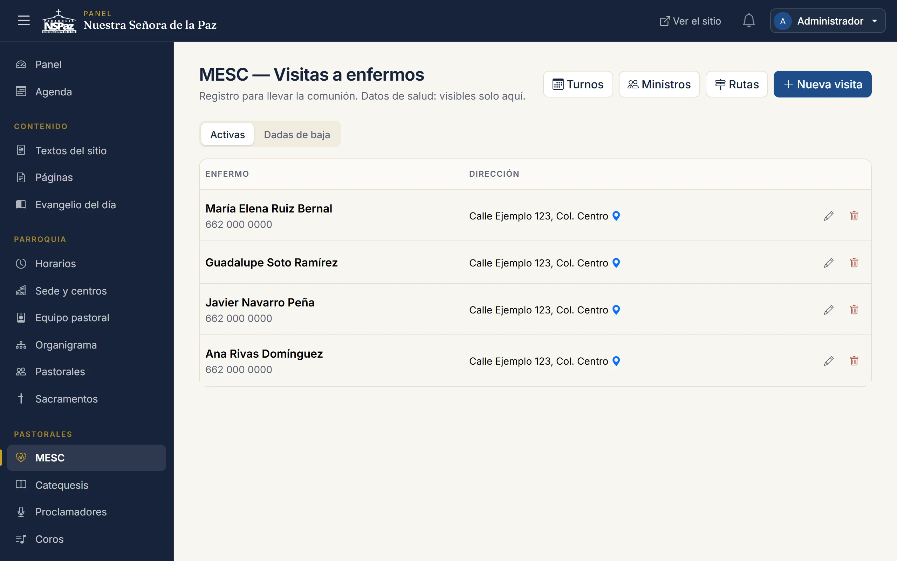
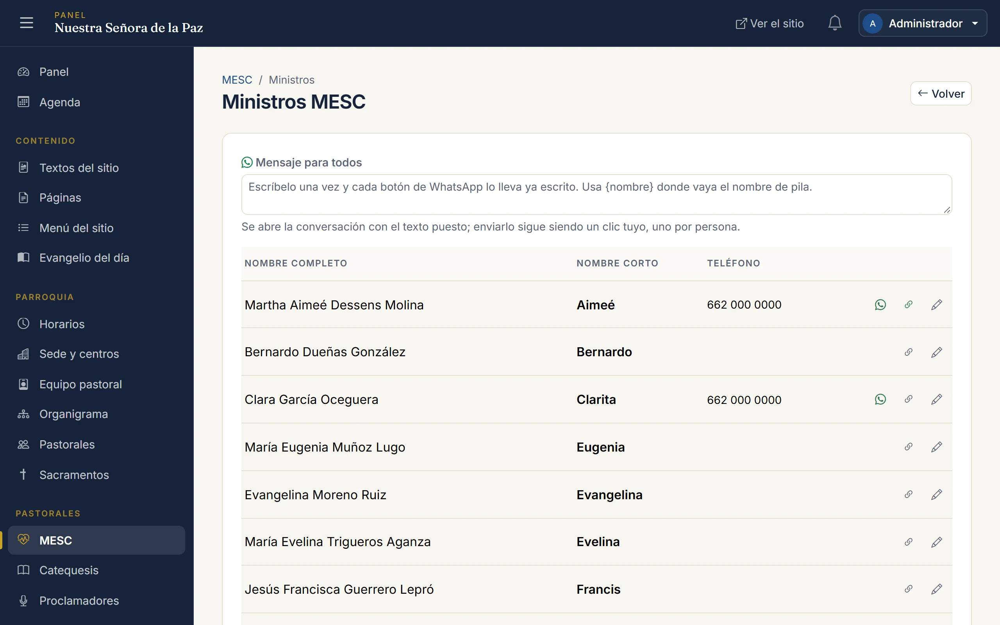
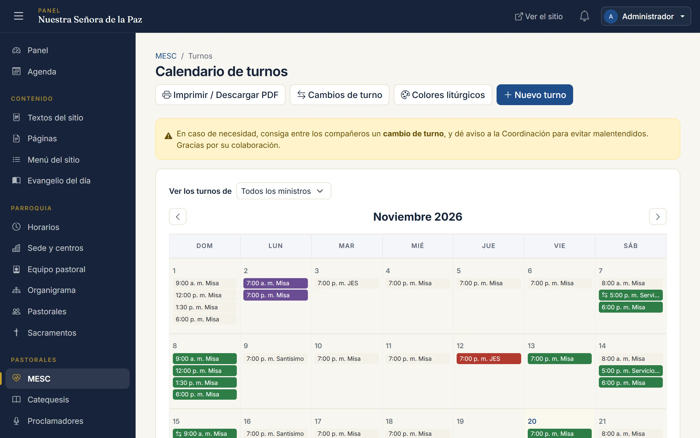
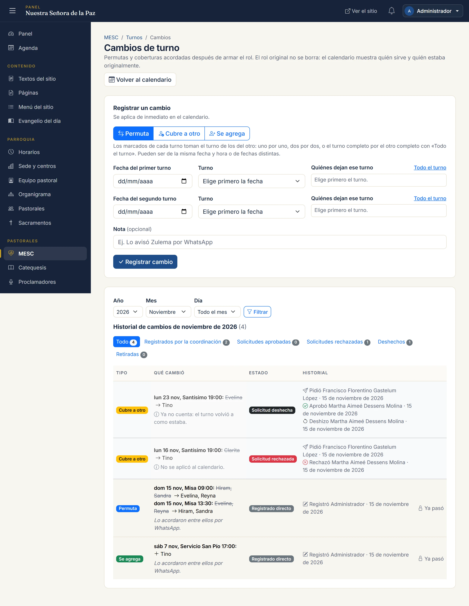
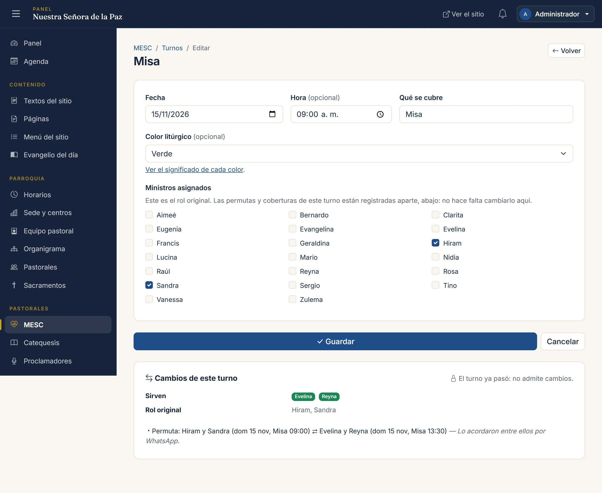
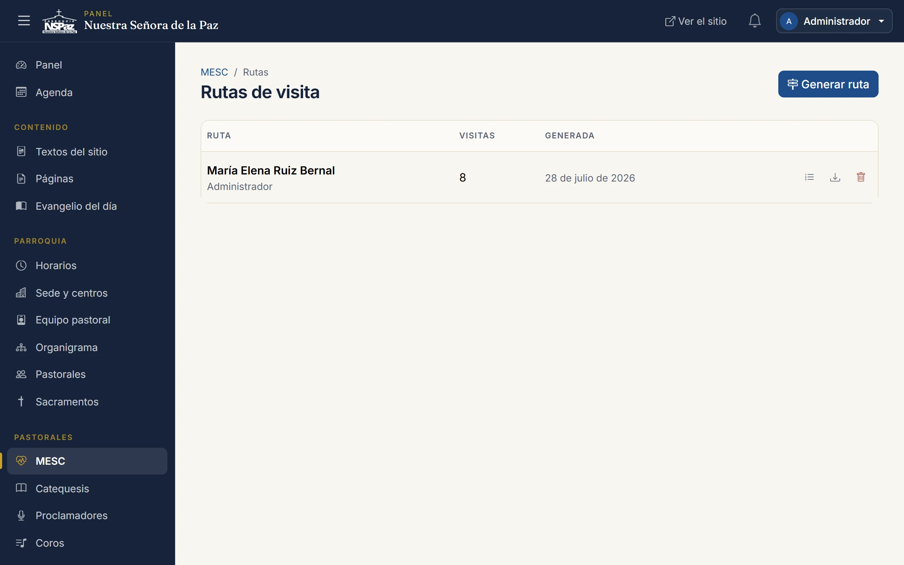

# 15. MESC — Ministros Extraordinarios de la Sagrada Comunión

El primero de los cuatro módulos que tienen pastorales concretas. MESC lleva
dos cosas a la vez: **quiénes son los ministros y cuándo sirve cada uno**, y
**a quién se le lleva la comunión a su casa**.

**Menú:** Pastorales → MESC.

Solo entran quienes administran esta pastoral, aunque el permiso de «ver MESC»
lo tengan todos los coordinadores: hay que administrar **esta** pastoral en
concreto. El capítulo 4 lo explica.

## Visitas a enfermos

Es la pantalla con la que abre el módulo, y la más delicada de todo el
sistema. Lo dice su propio subtítulo: **«Datos de salud: visibles solo aquí.»**

Cada visita guarda a quién se visita, su teléfono, su dirección y —si se
capturó— su ubicación en el mapa, que es lo que marca el pin azul. Se filtra
entre **Activas** y **Dadas de baja**: cuando alguien mejora o fallece, la
visita se da de baja, no se borra.

> Esta lista no sale del panel. No se publica y no se manda por WhatsApp, y la
> única forma de sacarla es la **ruta exportada** que se explica más abajo, que
> lleva solo las visitas de ese recorrido. Es la información de salud y el
> domicilio de personas mayores o enfermas de la parroquia; de todo lo que
> guarda el sistema, esto es lo que más cuidado merece.

En la captura de arriba los nombres y las direcciones están sustituidos por
ejemplos, por esa misma razón.

## Ministros

El catálogo de quiénes son ministros. Cada uno se da de alta **eligiéndolo del
equipo pastoral**: con eso, su nombre y su teléfono vienen de su ficha y se
mantienen al día solos. Queda un campo de nombre corto —cómo se le llama en el
rol— y la posibilidad de escribir un nombre libre si esa persona todavía no
está en el equipo.

Cada renglón trae su botón de **WhatsApp**, y arriba el cuadro de **Mensaje
para todos** que explica el capítulo 13: se escribe el recordatorio una vez y
cada botón abre la conversación con el texto ya puesto.

El botón de la **cadena** le manda a cada ministro su **enlace personal**: su
página sin contraseña, donde ve sus turnos y el rol del mes y pide cambios de
turno. El capítulo 13 explica ese cuadro. El **nombre corto** de esta lista es
también como lo saludan su página y el mensaje con su enlace.

El interruptor **Activo** saca a alguien del rol sin borrar su historial.

## Calendario de turnos

Quién sirve en cada misa. Se ve por meses, con las flechas para moverse, y cada
turno dice la hora y el servicio. El color de cada turno es el **color
litúrgico** del día.

Arriba, cuatro botones:

- **Nuevo turno**, para agregar uno.
- **Cambios de turno**, la pantalla de las permutas y coberturas que se explica
  enseguida.
- **Colores litúrgicos**, el catálogo de referencia —verde, morado, blanco,
  rojo— con el que se etiquetan los turnos según el tiempo o la fiesta.
- **Imprimir / Descargar PDF**, que saca la hoja del mes. Es la que se pega en
  la sacristía, y la razón de que este calendario exista: el rol se consulta en
  papel.

Encima del mes, **Ver los turnos de** deja en el calendario solo los turnos de
un ministro, con el número de turnos que tiene ese mes. El filtro se mantiene
al cambiar de mes y también vale para la hoja de imprimir, que sale con su nombre
en el título: así se le puede dar a cada quien su propio calendario. **Ver a
todos** quita el filtro.

En la parte de arriba aparece además el recordatorio que la coordinación quiso
dejar por escrito: si alguien no puede, **consigue el cambio con un compañero y
avisa a la coordinación**. Ese aviso ya no se queda en el aire: se registra en
**Cambios de turno**.

## Cambios de turno

Después de armar el rol, los ministros se acomodan entre ellos: uno no puede el
domingo y otro lo cubre. Esta pantalla es donde ese acuerdo queda escrito. Se
entra con el botón **Cambios de turno** del calendario.

**El rol original no se toca.** El cambio se guarda aparte y el calendario lo
aplica encima: muestra quién sirve y, al abrir el turno, quién estaba
originalmente. Por eso deshacer un cambio no obliga a acordarse de cómo estaba:
el rol original reaparece solo.

### Los tres tipos

- **Permuta**: los marcados de cada turno toman el turno de los del otro —uno
  por uno, dos por dos, o el turno completo por el otro completo con **Todo el
  turno**—. Pueden ser de la misma fecha y hora o de fechas distintas.
- **Cubre a otro**: alguien toma el lugar de otro en un turno, sin devolución.
- **Se agrega**: alguien más se suma a un turno; nadie sale.

Para elegir un turno primero se pone la **fecha**, y el sistema ofrece los
turnos de ese día; luego se marca quién deja el turno y quién entra. La
**nota** es opcional: «lo avisó por WhatsApp», «compromiso familiar».

### Quién lo registra

**La coordinación** lo registra directo, con **Registrar cambio**, y se aplica
de inmediato en el calendario.

**Los ministros lo piden.** Desde su enlace personal (capítulo 13), o desde su
cuenta si tienen una ligada a su ficha, cada ministro puede **pedir** un
cambio, siempre uno que lo incluya: que deje un turno, cubra a alguien o se
sume a uno. Pedirlo no cambia nada todavía:

- A quien coordina le aparece arriba de esta pantalla, en **Solicitudes por
  aprobar**, y en la campana del panel (capítulo 3). Las pedidas desde el
  enlace llevan la marca **enlace personal**.
- Con **Aprobar** se aplica en el calendario; con **Rechazar** —con un motivo,
  si se quiere— no se aplica.
- Quien pidió ve la respuesta en su página, o en la campana si pidió con su
  cuenta. Mientras nadie la resuelva, puede **retirarla**.

### El historial

Debajo están todos los cambios del mes —o del año entero, o de un solo día—
con el filtro de **Año**, **Mes** y **Día**, separados en pestañas: **Todo**,
**Registrados por la coordinación**, **Solicitudes aprobadas**, **Solicitudes
rechazadas**, **Deshechos** y **Retiradas**. Cada renglón dice el tipo, qué
cambió —tachado quien salió, después de la flecha quien entró—, su estado y su
historia: quién lo pidió, quién lo aprobó o lo deshizo, y cuándo.

**Nada se borra.** Un cambio equivocado se **deshace**, con el botón de la
flecha circular, y el turno vuelve a como estaba; el cambio se queda en el
historial como deshecho, con quién y cuándo. No se deshace uno si después hubo
otro cambio en el mismo turno: primero va el más reciente.

**Lo que ya pasó no se mueve.** Ningún cambio que toque un turno de antes de
hoy se registra, se aprueba, se deshace ni se retira: esos renglones dicen
**Ya pasó**.

### En el calendario y en la hoja impresa

Un turno con cambios lleva en el calendario el icono **⇆**. Al abrirlo, debajo
de los ministros asignados aparece **Cambios de este turno**: quiénes
**sirven**, cuál era el **rol original** y qué cambios lo tocaron, con un botón
para registrar otro. Las palomitas de **Ministros asignados** siguen siendo el
rol original: no hace falta moverlas.

Con **Ver los turnos de** puesto en una persona, el turno que ella cedió sale
tachado. Y en la hoja para imprimir, el turno cambiado dice quién sirve y, en
pequeño, **en lugar de** quién.

## Rutas de visita

Una ruta es un recorrido: el orden en que se visita a varias personas en una
misma salida.

Se crean desde **Generar ruta**: se le pone nombre y se marcan las visitas que
va a incluir, de entre las activas. Una vez creada, se puede **reordenar** —el
orden es el del recorrido— y **exportarla**, que es lo que se le pasa a quien
va a hacer la vuelta: una hoja de cálculo (CSV) con el orden, el enfermo, su
dirección y teléfono, quién pidió la visita y las notas. **Ese archivo lleva
los mismos datos delicados que la lista**: se le entrega solo a quien va a
hacer el recorrido, y se borra cuando ya no hace falta.

Si no hay ninguna visita activa, el sistema lo dice y no deja generar una ruta
vacía.
