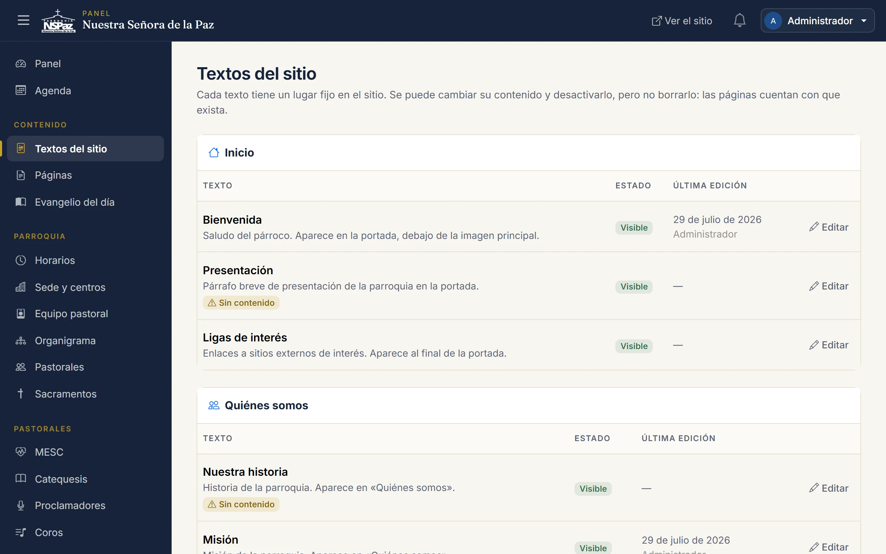
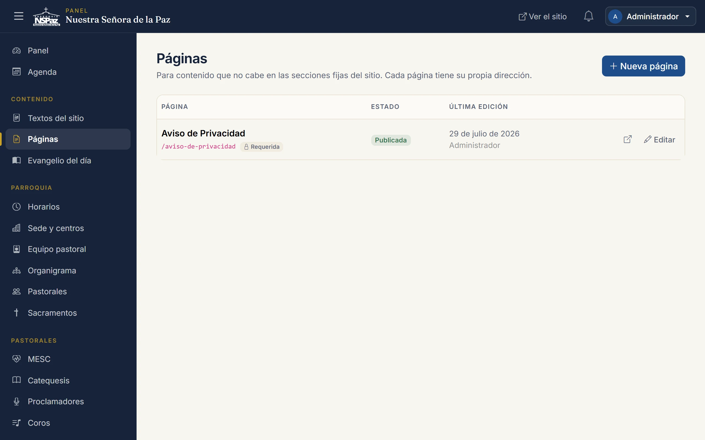
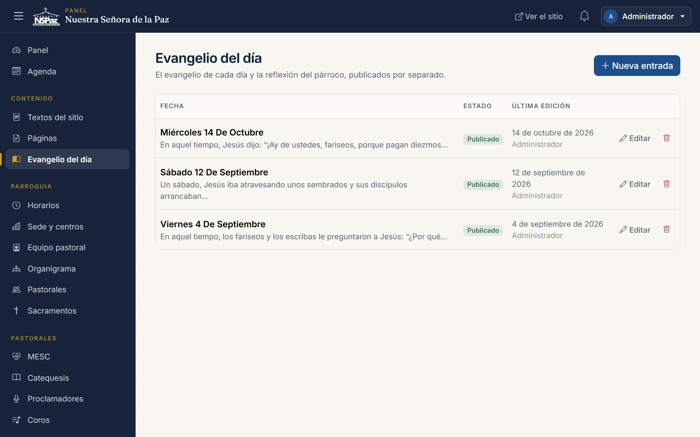

# 19. Páginas, bloques y evangelio del día

Los módulos de la sección **Contenido** del menú. Cada uno para una cosa
distinta:

- **Textos del sitio** (bloques): los párrafos que ya tienen su hueco hecho.
- **Páginas**: secciones nuevas, con su propia dirección.
- **Menú del sitio**: qué va en el menú de arriba, en qué orden y con qué nombre.
- **Evangelio del día**: la lectura y la reflexión de cada día.

## El editor de texto

Los textos largos del panel —páginas, textos del sitio, avisos, eventos,
cursos, sacramentos, la ficha de las pastorales y el evangelio— se escriben
con el mismo editor. Su barra tiene, de izquierda a derecha:

- **Negrita, cursiva y subrayado.**
- **Título, subtítulo y párrafo normal**, para darle orden a un texto largo.
- **Lista con puntos y lista numerada.**
- **Insertar enlace** (primero se selecciona el texto) y **quitar enlace**.
- **Insertar imagen.**
- **Quitar el formato**, para dejar un pedazo como texto simple.

Al pegar texto copiado de Word o de otra página se pega solo el texto, sin sus
colores ni tipos de letra: el sitio usa los suyos.

### Insertar una imagen

1. Pon el cursor donde quieres la imagen.
2. Toca el botón **Insertar imagen** (el del cuadrito con montaña) y elige la
   foto de tu computadora o de tu celular.
3. El panel pide una **descripción corta**. Es opcional, pero conviene: es lo
   que escucha quien usa un lector de pantalla y lo que se muestra si la imagen
   no carga. Algo como «Cartel de la kermés 2026».
4. La imagen se sube y aparece en el texto. Sigue escribiendo debajo.
5. **Guarda** el formulario, como siempre.

Se aceptan JPG, PNG, WebP y GIF de hasta **4 MB**; si la foto es más ancha de
1600 puntos, el sistema la reduce sola. En el sitio la imagen se ve completa,
centrada, sin pasar del ancho del texto ni del alto de la pantalla. Para
quitarla, se selecciona dentro del editor y se borra como cualquier texto.

> **Si el botón no hace nada,** recarga la página del formulario: el navegador
> guarda una copia del editor y a veces tarda en enterarse de que cambió.

## Textos del sitio

Son los textos sueltos que el sitio tiene repartidos: la presentación de la
portada, la historia de la parroquia, la misión, la visión, las ligas de
interés, la introducción de la página de sacramentos.

Dos de la portada cambiaron con el rediseño del sitio:

- **Presentación** es el texto que va debajo del lema, en la cabecera de la
  portada. Mientras esté vacío, sale un texto de bienvenida fijo.
- **Bienvenida** ya no se muestra en ninguna parte. Si se quiere un saludo del
  párroco en la portada, se escribe en **Presentación**.

**Aquí no se crean ni se borran**: la lista viene dada, porque cada uno tiene
su hueco reservado en una página concreta. Lo que se hace es **editarlos**. Al
abrir uno, el panel dice dónde aparece, para no tener que adivinarlo.

Cada bloque tiene su **título**, su **contenido** —con el editor de texto— y un
interruptor de **activo**: apagado, la sección simplemente no se dibuja en el
sitio, sin dejar un hueco vacío.

El listado muestra además **la última edición** de cada texto, que es la forma
rápida de ver qué lleva años sin tocarse.

## Páginas

Para lo que no cabe en ningún módulo: la historia larga de la parroquia, un
reglamento, la convocatoria de una peregrinación. Cada página tiene:

- **Título.**
- **Dirección.** La parte final de la URL —`/pagina/reglamento`—, que se genera
  sola a partir del título y se puede corregir. Conviene dejarla quieta una vez
  publicada: si alguien ya la compartió, cambiarla rompe ese enlace.
- **Contenido**, con el editor.
- **Resumen para buscadores.** Dos líneas: es lo que Google muestra debajo del
  título.
- **Orden** y **Publicada**. Mientras no esté publicada, su dirección responde
  «no encontrada».
- **Mostrar en el menú.** Con esta palomita, la página entra al final del menú
  del sitio. Su lugar y el nombre con que aparece se cambian en **Menú del
  sitio**.

Una página es texto fijo: se alimenta abriéndola y editándola. No toma sola
avisos ni eventos. Para lo que cambia cada semana —noticias, anuncios— está
**Avisos**, que sale en el recuadro de la portada y se retira solo al vencer.

## Menú del sitio

Todo lo que va en el menú de arriba del sitio, entre **Inicio** (siempre
primero) y **Contacto** (siempre al final, en el botón dorado), en una sola
lista: las secciones fijas —Quiénes somos, Horarios, Sacramentos, Pastorales,
Cursos, Avisos, Eventos, Galería— y todas las páginas.

- **Mostrar.** Apagado, la entrada desaparece del menú. La sección sigue
  existiendo y su dirección sigue funcionando: solo deja de estar en el menú.
- **Flechas.** Suben o bajan la entrada. Una página puede ir en cualquier
  lugar, también entre las secciones fijas.
- **Nombre en el menú.** Vacío, se usa el de siempre. Sirve para llamar a
  «Quiénes somos», por ejemplo, «Nuestra parroquia».
- **Guardar menú.** Nada cambia en el sitio hasta guardar.

Dos avisos de la propia pantalla: una página **sin publicar** no aparece
aunque esté marcada, y **Cursos** tampoco si está apagada en Configuración →
Secciones del sitio.

No tiene relación con **Textos del sitio**: cambiar el título de un texto no
cambia el menú.

## Evangelio del día

La lectura del día y, si da tiempo, la reflexión del párroco. Cuando hay una
entrada publicada para hoy, aparece en la portada, justo antes de los horarios,
en dos columnas: el evangelio a la izquierda y la reflexión a la derecha. Si los
textos son largos, cada columna enseña sus primeras líneas y un botón **Leer
completo**. Si no hay entrada para hoy, la portada sencillamente no dibuja esa
sección.

Cada entrada tiene:

- **Fecha.** Una por día. Si ya existe una entrada para esa fecha, **se
  actualiza en vez de crear otra**, así que no hay manera de acabar con dos
  evangelios del mismo día.
- **Evangelio.** La cita y el texto. No hace falta escribir «EVANGELIO» arriba:
  la portada pone esa etiqueta sola. Lo mismo con la reflexión: escribir
  «REFLEXIÓN:» al principio hace que se lea dos veces.
- **Reflexión.** Opcional, y a propósito: hay días en que no da tiempo de
  escribirla, y el evangelio debe poder salir igual.
- **Publicado.** Mientras esté apagado, no aparece en el sitio. La portada
  enseña solo la entrada **de hoy**, así que se pueden dejar preparadas y
  publicadas las de varios días: cada una sale sola en su fecha.
